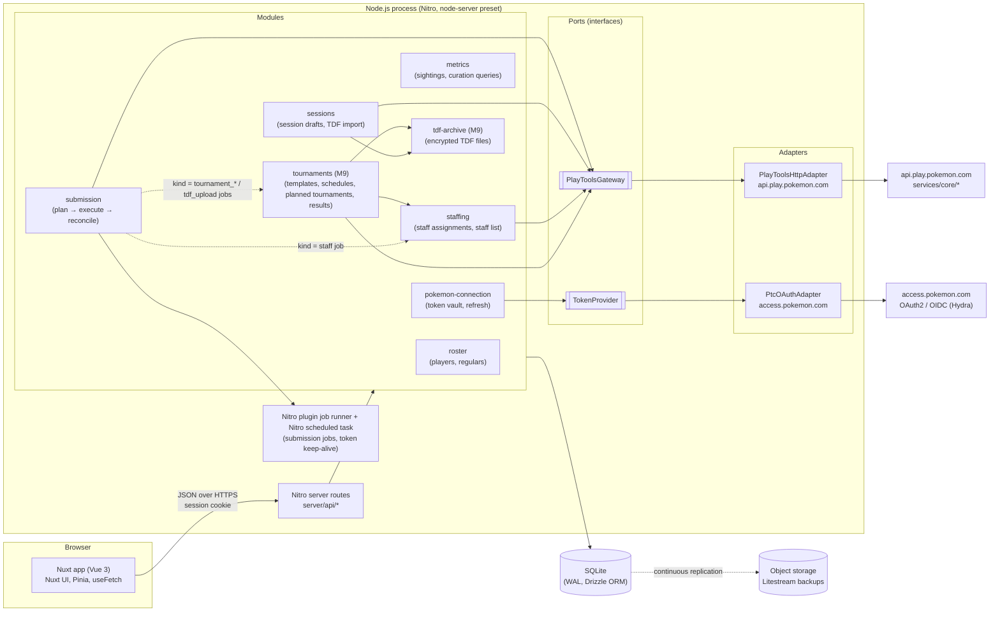
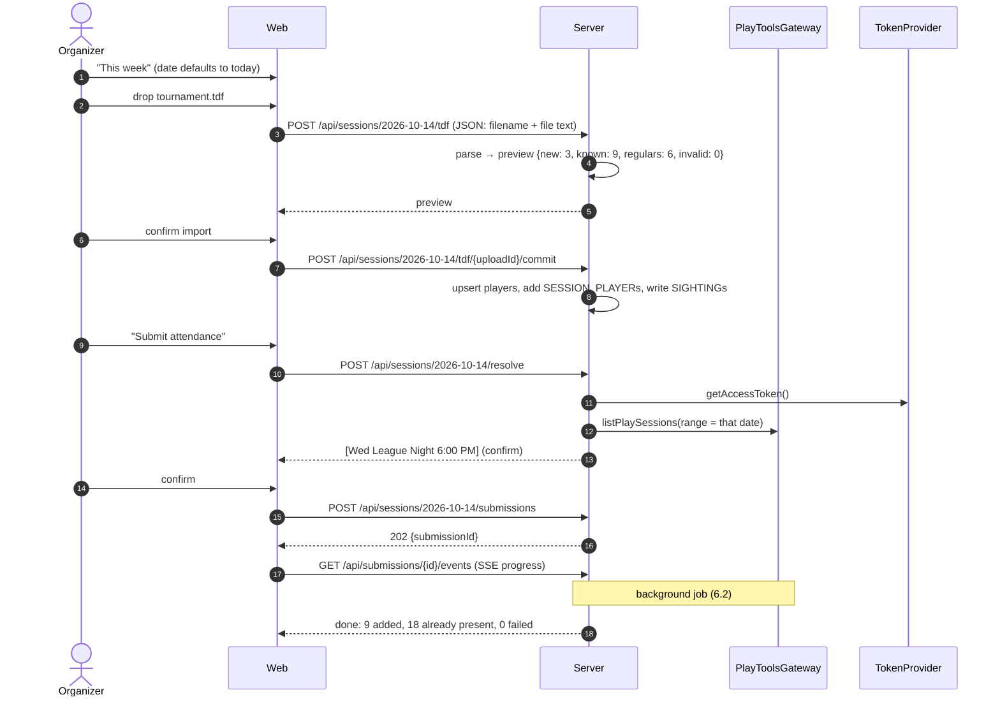
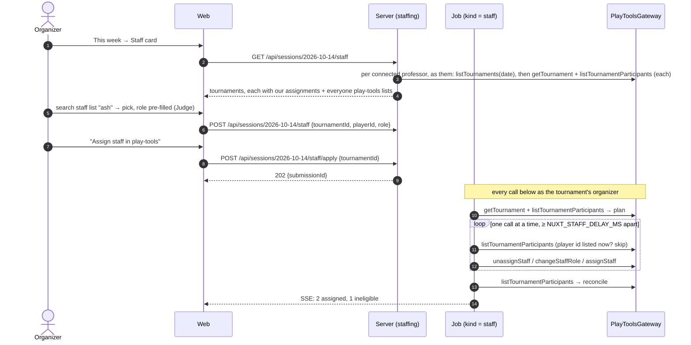
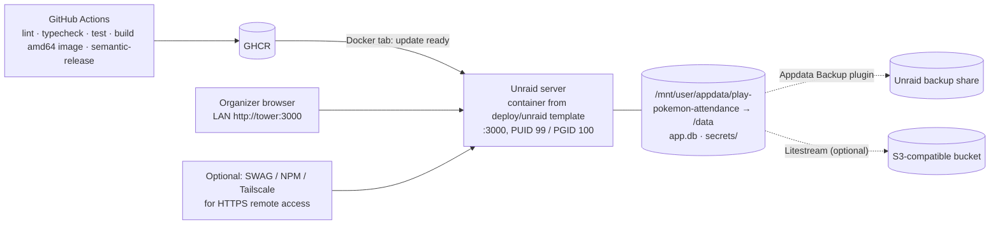

# Play! Pokémon League Attendance — System Architecture

Status: **Accepted** (retroactively, 2026-10-12) · Date: 2026-10-10 · Author: Martin Fracker, Jr.

## 1. Context

Taking attendance for a Play! Pokémon league in `play-tools.pokemon.com` means
entering players one at a time, every week. The predecessor CLI
([Towerism/play-pokemon-attendance](https://github.com/Towerism/play-pokemon-attendance))
removed most of that toil with three scripts:

| Script           | What it does                                                                                           |
| ---------------- | ------------------------------------------------------------------------------------------------------ |
| `extract-tdf.js` | Parses a tournament `.tdf` (XML) into `players.json` (`firstname lastname`, `userid`).                  |
| `index.js`       | Removes regulars from `players.json`, then `POST`s both lists to `.../play_sessions/{id}/records/_bulk/`, 15 s apart. |
| `delete.js`      | Pages through a session's records and deletes them one by one (to undo a bad run).                       |

Pain points that remain with the CLI:

1. A bearer token has to be copied by hand out of browser devtools on every run.
2. A play-session **GUID** has to be found and pasted in. The organizer thinks in *dates*.
3. The activity group (league) ID is hardcoded.
4. Rosters live in JSON files in a git repo. There is no history and no record of who actually shows up.
5. The run is not idempotent. Re-running it sends everyone again, and partial failures are only visible in console output.

## 2. Goals and non-goals

### Goals (v1)

- **G1 Regular players.** Maintain a curated list of players who are entered every session.
- **G2 Session players.** Maintain the list of non-regular players for a specific session date: add them by hand or by …
- **G3 TDF import.** … uploading a `.tdf`, which extracts its players into the session players (deduplicated against regulars and against the existing session list).
- **G4 Submit attendance.** One click. The app obtains a valid JWT from `access.pokemon.com` **without manual token copying**, asks *which date* the attendance is for, resolves that date to the play session, and uploads regulars ∪ session players with no duplicates.
- **G5 Metrics.** Every player ID that ever enters the system is tracked, with enough metrics to curate the regulars list by hand (promote frequent non-regulars, demote regulars who stopped coming).
- **G6 Assign staff** (M8, [ADR-0007](adr/0007-staff-assignment.md)). In the same weekly flow, assign one or more staff (player ID + role; several people, roles may repeat) to each of the date's tournaments in play-tools, so they earn staff points. A search over the league's **staff list** (everyone who has staffed its tournaments, seeded from play-tools; names editable, since play-tools may show a dead name) fills in the player and their last role.
- **G7 Tournaments** (M9, [ADR-0010](adr/0010-tournament-templates-and-lifecycle.md)). Create, edit (any field, optionally across its schedule), cancel and reschedule the league's tournaments in play-tools from the app, custom events and premier series (League Challenge, League Cup, Prerelease) alike. **Templates** hold a tournament's settings, **scaffolds** group templates held back to back, and **schedules** repeat a scaffold weekly, monthly or quarterly. The app plans the upcoming dates, and the organizer creates them with one click: chosen ones, or every one a schedule plans up to a date they pick (e.g. the 3rd Tuesday of every month through the end of the year). The app also tracks the events the league must hold (a League Cup per quarter and a League Challenge per month, for each of TCG, GO and VGC) and warns, loudly and early, before one is missed.
- **G8 Upload results** (M9, [ADR-0011](adr/0011-tdf-results-upload.md)). Upload a tournament's `.tdf` to play-tools from its This week card, the same drop that imports its players for attendance.

### Non-goals (v1)

- Replacing any other play-tools feature (running tournaments, admin actions, reporting). Staff *assignment* moved into scope as G6 (ADR-0007); creating, cancelling and rescheduling tournaments and uploading their results as G7 and G8 (ADR-0010, ADR-0011).
- Real-time multi-user editing. One or two organizers per league is the expected load. (Several professors' Pokémon accounts can be connected at once, ADR-0008; the app itself still has one organizer login.)
- Storing Pokémon Trainer Club **passwords** (see [ADR-0003](adr/0003-pokemon-auth-pkce-refresh-token.md)).
- Storing minors' birthdates or other PII from the TDF beyond name and player ID.

### Quality attributes (ranked)

1. **Correctness of submitted attendance.** Wrong or duplicate records are the worst outcome.
2. **Low operator effort.** The weekly flow is ≤ 3 clicks once the TDF is uploaded.
3. **Security of the Pokémon credential.** The refresh token can act as the organizer in play-tools.
4. **Cheap and painless to run on Unraid.** A hobby budget, one container and one appdata folder. Install is a template form with no required fields, and credentials are set up in the browser (see [ADR-0006](adr/0006-docker-on-unraid.md)).
5. **Resilience to upstream change.** The play-tools API is unofficial and undocumented, so changes must stay contained in one adapter.

## 3. Architecture at a glance

**Pattern:** a modular monolith, with a hexagonal (ports and adapters) boundary
around the Pokémon integration. One team, one deployable, tiny scale. It is
built as **one Nuxt 4 application**: Vue pages in `app/`, and Nitro server
routes, plugins and tasks in `server/`. See
[ADR-0001](adr/0001-modular-monolith-nuxt.md).



### Tech stack

| Layer            | Choice                                                                    | Why                                                                                                  |
| ---------------- | ------------------------------------------------------------------------- | ---------------------------------------------------------------------------------------------------- |
| Language         | TypeScript everywhere                                                     | One language. Shared Zod schemas between client and server through Nuxt's `shared/` directory. The existing code is already JS. |
| Framework        | **Nuxt 4** (Vue 3, Vite, Nitro)                                           | One project, one build and one origin for UI and API. File-based routing on both sides. End-to-end typed `$fetch`/`useFetch` from server routes. |
| Rendering        | SSR off for app pages (`routeRules: { '/**': { ssr: false } }`), or SSR with auth middleware | Everything sits behind a login, so SEO is irrelevant. SPA mode keeps hydration and auth simple. It is a one-line switch if SSR is ever wanted. |
| UI               | **Nuxt UI** (Tailwind-based components: `UTable`, `UFileUpload`, `UModal`, toasts) + `@nuxt/icon` | Tables, file drop, forms and toasts cover nearly every screen out of the box, and it is mobile-friendly. |
| Client state     | `useFetch` / `useAsyncData` for server state; **Pinia** only for UI state (the progress drawer, M5); the session date lives in the `?date=` query | Nuxt's data fetching already handles caching, refresh and dedupe, so a separate query library isn't needed. |
| Forms            | Nuxt UI `UForm` + Zod schemas from `shared/`                              | The same validation runs in the browser and in `readValidatedBody` on the server.                    |
| Server           | **Nitro** (h3): `server/api/**` routes, `server/plugins` (job runner boot), `server/tasks` + `scheduledTasks` (keep-alive) | Built into Nuxt. The `node-server` preset gives a long-lived process for jobs, timers and SSE (`createEventStream`). |
| App auth         | **`nuxt-auth-utils`** (sealed session cookies, `requireUserSession`, `hashPassword` / `verifyPassword`, WebAuthn-ready) | Official community module. Avoids hand-rolled session code.                                          |
| Database         | SQLite (WAL) via Drizzle ORM + drizzle-kit migrations, with `better-sqlite3` | Thousands of rows, not millions. Zero ops. See [ADR-0002](adr/0002-sqlite-drizzle.md).            |
| Backups          | Unraid *Appdata Backup* of `/data`, plus optional Litestream → S3-compatible bucket (Backblaze B2 / R2) | One folder to back up. Litestream adds continuous, point-in-time restore when it is configured. |
| XML              | `fast-xml-parser` (entities disabled)                                     | Same parser the CLI uses, with the TDF shape already proven.                                         |
| Crypto           | Node `crypto` AES-256-GCM (refresh-token vault)                           | No extra service is needed.                                                                          |
| Packaging        | Single `linux/amd64` Docker image on GHCR running `node .output/server/index.mjs`, built by pnpm, plus an Unraid template | **Production runs on Unraid** ([ADR-0006](adr/0006-docker-on-unraid.md)). The same image runs on any Docker host. |
| Testing          | Vitest + `@nuxt/test-utils` (unit tests; server tests drive the built app over HTTP), an in-process HTTP fake of the Pokémon APIs (`test/server/fake-pokemon.ts`, reached through `NUXT_POKEMON_*_URL`) for the server and E2E tests, Playwright for the browser journeys (`test/e2e/`, Chromium at phone size) |                                                     |
| Quality          | `@nuxt/eslint`, `vue-tsc` typecheck in CI                                  |                                                                                                      |

### Repository layout (single Nuxt 4 project)

```
app/                         Vue side (Nuxt 4 `app/` dir)
  pages/
    index.vue                This week
    regulars.vue
    players.vue
    history/index.vue, history/[id].vue
    settings.vue
    login.vue
  components/                SessionPlayerTable, TdfDropzone, TdfPreview, SubmitDialog,
                             SubmissionProgress, PlayerMetricsTable, PokemonConnectionCard, …
  composables/               useSessionDraft(date), useSubmissionEvents(id), usePokemonConnection()
  stores/                    ui.ts (Pinia: drawer state, M5)
  middleware/auth.global.ts  redirect to /login when there is no session
server/                      Nitro side
  api/                       file-based routes (see §7), e.g. sessions/[date]/tdf.post.ts
  modules/                   domain modules (plain TS; no h3 imports)
    roster/  sessions/  submission/  metrics/  staffing/ (M8)  tournaments/ (M9)  tdf-archive/ (M9)  pokemon/{ports,adapters,vault}/ + pokemon/connection.ts
  plugins/jobs.ts            boot job runner; mark `running` submissions `interrupted`
  tasks/pokemon/keepalive.ts Nitro task, wired by `nitro.scheduledTasks` (hourly)
  db/                        drizzle schema, migrations, client
  utils/                     auto-imported helpers: useDb(), requireLeague(event), container
shared/                      auto-imported in app/ and server/ (Nuxt 4)
  schemas/                   Zod DTOs
  types/                     PlayerId, SessionDate
  tdf/                       pure TDF parser (no I/O), heavily unit-tested
nuxt.config.ts
Dockerfile                   multi-stage: pnpm build → node:22-slim runtime + litestream
docker/entrypoint.sh         PUID/PGID chown + gosu drop, UMASK, optional Litestream supervision (M7)
server/bootstrap/launcher.ts production entry (`.output/launcher.mjs`): secret bootstrap and derived env, then loads Nitro
deploy/unraid/               Unraid Docker template (XML) + icon
docs/architecture/           this document + ADRs
docs/deploy/unraid.md        install / first run / backup / restore guide
```

Module rules:
- `server/api/*` handlers stay thin: they validate input, call a module service, and map errors to HTTP responses.
- Modules talk to each other only through their exported service interfaces, never through each other's tables.
- Only `server/modules/pokemon/adapters/*` may make HTTP calls to `*.pokemon.com`. Enforce this with an ESLint `no-restricted-imports` / boundaries rule.
- Modules don't import h3 or Nuxt APIs, so they unit-test as plain TS.

## 4. Pokémon integration (the risky part)

The integration was reverse-engineered from the current production play-tools
bundle (`play-tools.pokemon.com/assets/index-*.js`) and the existing CLI.

### 4.1 Identity: access.pokemon.com

- The server is OAuth2/OIDC on Ory Hydra (`/oauth2/auth`, `/oauth2/token`, `/oauth2/sessions/logout`).
- play-tools uses **authorization code + PKCE (S256)** as a **public client**:
  - `client_id=op-tools-app`
  - `scope=openid organized_play offline`
  - `audience=https://op-core.pokemon.com`
  - `redirect_uri=https://play-tools.pokemon.com/loggedIn`
- Token requests are `application/x-www-form-urlencoded` to `https://access.pokemon.com/oauth2/token`.
- Because of `offline`, a **refresh token** is issued. The refresh call is
  `grant_type=refresh_token&client_id=op-tools-app&refresh_token=…`, with no client secret.

**Design ([ADR-0003](adr/0003-pokemon-auth-pkce-refresh-token.md)):** connect once, then refresh forever.

```mermaid
sequenceDiagram
  autonumber
  actor O as Organizer
  participant W as Web SPA
  participant S as Server (pokemon module)
  participant A as access.pokemon.com
  participant P as play-tools.pokemon.com

  O->>W: Settings → "Connect Pokémon account"
  W->>S: POST /api/pokemon/connect/start
  S->>S: create code_verifier, challenge, state (stored 10 min)
  S-->>W: authorizeUrl
  W->>A: open authorizeUrl (new tab)
  O->>A: log in (PTC username / password / MFA, on Pokémon's own page)
  A-->>P: 302 /loggedIn?code=…&state=…
  Note over O,P: Capture the code (see 4.2 for capture options)
  O->>W: paste redirected URL (or extension posts it)
  W->>S: POST /api/pokemon/connect/complete {url}
  S->>S: verify state
  S->>A: POST /oauth2/token (authorization_code + code_verifier)
  A-->>S: access_token (JWT), refresh_token, id_token
  S->>P: identity: personal group owner.player_id (core/users/{sub}/activity_groups/)
  S->>S: encrypt refresh_token (AES-GCM) → that professor's pokemon_connection row
  S->>P: league discovery (core/users/{sub}/activity_groups/)
  S-->>W: professor added or reconnected; a league with no submitting professor binds their only league, otherwise the organizer picks
```

After connecting, `TokenProvider.getAccessToken()`:

1. Returns the cached access token if it is valid for at least 2 more minutes.
2. Otherwise takes a **per-connection mutex** and calls the refresh grant.
3. **Persists the rotated refresh token in the same transaction** before anything else. Hydra rotates refresh tokens and reusing an old one revokes the whole chain.
4. If the refresh returns `invalid_grant`, marks the connection `needs_reconnect`, surfaces a banner in the UI and fails the job with a clear message.

A **keep-alive job** refreshes every hour so the chain never ages out during a
week off. The real refresh-token TTL is spike S2.

As built (M4), in `server/modules/pokemon/connection.ts`:

- **Connect attempts** (PKCE verifier + `state`) are held **in memory only**, bound to the app user and league,
  for 10 minutes, and consumed by the first `complete` whether or not the exchange succeeds. A restart drops
  pending attempts; the organizer just clicks Connect again.
- `complete` errors carry `data.code`: `invalid_url`, `unknown_attempt`, `expired`, `code_rejected` (Hydra refused the code).
- **Persist-before-use:** the rotated refresh token is written before the access token is cached or returned. If the
  write fails, no token is handed out.
- **A vault key that no longer opens the stored token** (lost or replaced key) marks the connection `needs_reconnect`.
- **League discovery** runs right after connecting. With exactly one `league` group it is bound automatically;
  otherwise Settings asks. A discovery failure doesn't fail the connect. Reconnecting the same account (`sub`)
  keeps the chosen league; a different account clears it.
- **Keep-alive** is the Nitro task `pokemon:keepalive`, run at the top of every hour. It refreshes when the last refresh
  is ≥ 45 min old (below the interval, so a late run still refreshes), and never calls Hydra for a connection already
  marked `needs_reconnect`.
- **Disconnect** revokes at `/oauth2/revoke` on a best-effort basis and always deletes the stored token.
- The manual access-token fallback (`POST /pokemon/token`, §4.2 c) is **not built yet**, because S1 made paste-back work.

As built (#66, [ADR-0008](adr/0008-plural-pokemon-connections.md)): **one connection per professor**, up to 10.

- **Identity at connect:** after the code exchange, the gateway's `getProfessorProfile()` reads the `personal`
  activity group's `owner.player_id` (never a league's owner, who is the store owner). Pokémon has no name for the
  professor (S7); the organizer may give one in Settings, for display only ("Professor <player id>" otherwise). No player id fails the connect (`profile_unavailable`) and stores nothing;
  Pokémon down at that moment is `upstream_unavailable`. Either way the fresh login is revoked. Nothing has rotated yet, so
  reading the identity with the new access token before storing the chain can't revoke it.
- **Add or reconnect:** a known player id is a reconnect (token, status and name replaced, league binding kept); a new one
  is added, or refused `connection_limit` at the cap (checked in the same transaction as the insert). Attempts are bound to
  the app user only, since the professor isn't known until the exchange.
- **Per connection:** sealed refresh token (AAD `pokemon_connection:<id>`), access-token cache, refresh mutex and status.
  `TokenProvider.getAccessToken(connectionId)`. One professor's `invalid_grant` marks only them `needs_reconnect`.
- **The league names its submitting professor** (`league_upstream`). Attendance calls (submissions of every kind and
  the play-session resolver) go through a gateway built for that connection (`leagueGateway(leagueId)`); with none
  chosen each call fails `not_connected`. A job keeps the connection it started with and never falls back to another
  professor. Each submission records the professor it ran under.
- **Tournaments go through their organizer** ([ADR-0009](adr/0009-tournaments-as-their-organizer.md), #75). The Staff
  card lists every connected professor's tournaments, each with that professor's own connection
  (`connectionGateway(connectionId)`, from `listActingConnections()`). Every staff action, and the staff job, uses only
  the connection of the tournament's organizer (`organizer_not_connected` / `needs_reconnect` otherwise), and a
  staff job records them. Import staff reads every connected professor.
- **The league is one every professor shares** (#75). `GET /leagues/upstream` lists the leagues all connected
  professors have, each read as that professor; one who needs a reconnect is left out and named (`excluded`), any other
  failure fails the list. `PUT /settings` refuses any other league, and a connect binds one automatically only when
  exactly one is shared.
- **Keep-alive** runs the 45-minute rule for every connection, one at a time, logging one outcome per player id.
- **Upgrade from v1:** migration 0009 copies the league-keyed row into an unidentified connection and its binding into
  `league_upstream`. The `pokemon` boot plugin re-seals its token under the new AAD before anything can refresh it, then
  refreshes it in the background; the first refresh fills in the professor. If that professor is already connected under
  another row, the rows merge (their own row and the league binding stay; the carried-over chain is revoked). An
  unidentified connection that needs a reconnect is claimed by the next connect.

### 4.2 Capturing the authorization code

The redirect URI is fixed to play-tools, so our app cannot receive the
callback directly. Options, in order of preference (spike S1 decides):

| # | Mechanism                                                                                               | UX                    | Notes                                                                                                                     |
| - | ------------------------------------------------------------------------------------------------------- | --------------------- | ------------------------------------------------------------------------------------------------------------------------- |
| a | **Paste-back:** after login, copy the `…/loggedIn?code=…` URL from the address bar into our app         | One paste, once a month or less | Works only if the code is still unused when pasted. The play-tools SPA will see a `state` it didn't create; S1 checks whether it tries to redeem the code anyway. |
| b | **Companion browser extension** (MV3, ~50 lines): watches navigations to `play-tools.pokemon.com/loggedIn?code=` and posts the URL to our app (optionally stopping the navigation) | Zero-touch | Most reliable capture. An extra install, but only for the organizer.                                                      |
| c | **Manual access-token paste** (status quo)                                                              | Every session         | Always-available fallback, kept behind "Advanced".                                                                        |

Rejected: storing the PTC password and driving a headless browser
(`Playwright`) to log in. It stores the most sensitive credential, it breaks
on CAPTCHA/MFA, and it looks the most like "automated means" under the
play-tools Terms. Details are in ADR-0003.

### 4.3 Organized Play API: api.play.pokemon.com/services/core

Base: `https://api.play.pokemon.com/services/` (the OP gateway). Endpoints used:

| Purpose               | Method & path                                                                 |
| --------------------- | ----------------------------------------------------------------------------- |
| Discover leagues      | `GET core/users/{userId}/activity_groups/` (userId = JWT `sub` / profile)     |
| List play sessions    | `GET core/activity_groups/{groupId}/play_sessions/?status=active\|scheduled\|completed&page=&page_size=` |
| Existing attendance   | `GET core/activity_groups/{groupId}/play_sessions/{sessionId}/records/?player=true&page=&page_size=` |
| Bulk add attendance   | `POST core/activity_groups/{groupId}/play_sessions/{sessionId}/records/_bulk/` body `[{participant:{player_id}, role:null, player:true, origin:"roster", updated:""}]` |
| Remove one record     | `DELETE core/activity_groups/{groupId}/play_sessions/{sessionId}/records/{recordId}/` |

`PlayToolsGateway` port (the domain never sees raw payloads):

```ts
interface PlayToolsGateway {
  listLeagues(): Promise<League[]>;
  listPlaySessions(groupId: string, range: DateRange, statuses?): Promise<PlaySession[]>; // {id, type, products, startsAt, endsAt, editableUntil, status}
  listAttendance(groupId: string, sessionId: string): Promise<AttendanceRecord[]>; // {recordId, playerId, isPlayer, name}, every role
  addAttendanceBulk(groupId: string, sessionId: string, playerIds: PlayerId[]): Promise<BulkResult>;
  // BulkResult = {status: 'added', records: [{playerId, recordId}]} | {status: 'rejected', alreadyPresent, failed}
  removeAttendance(groupId: string, sessionId: string, recordId: string): Promise<'removed' | 'not_found'>; // M7 (undo)
}
```

As built (M5): `listAttendance` reads the **unfiltered** records list, because `?player=true` hides staff
records and upstream refuses to add those participants again (S4). `addAttendanceBulk` mirrors S4's
all-or-nothing semantics: a 400 maps `errors.body["<i>.participant.player_id"]` back to the player
(`cannot_duplicate_participant` → `alreadyPresent`, anything else → `failed`; a 400 naming nobody fails
everyone), a 201 maps record guids to players in request order, a 5xx throws `unavailable`, and an id that
isn't digits only is refused locally before any call.
`removeAttendance` (M7) sends `DELETE …/records/{recordId}/`: 204 → `removed`, 404 → `not_found` (someone removed it
already), other statuses map like the rest. A record id that isn't `^[A-Za-z0-9-]{1,64}$` is refused locally, so it
can never change the request path.

The adapter is the only place that knows about Pokémon's JSON shapes,
pagination quirks (`results` vs `data`), and headers. Responses are parsed
with Zod using `passthrough()`, and an unexpected shape fails loudly with the
raw body logged. Outbound calls are throttled: one bulk batch at a time, by
default 20 players at least 10 s apart (configurable). That is gentler per
second than the CLI's 50 every 15 s, and small batches rarely hit the 502
gateway timeout (ADR-0004 update). Retries happen on 429/5xx only.

#### Staff assignment (M8; contract from spike S6)

Tournaments are their own resource, separate from play sessions. Spike S6 recorded their staff contract live
([spikes.md](spikes.md#s6-staff-assignment-done-2026-10-11), fixtures in `__fixtures__/s6/`). See
[ADR-0007](adr/0007-staff-assignment.md).

| Purpose                     | Method & path (under `services/`)                                                                                  |
| --------------------------- | ------------------------------------------------------------------------------------------------------------------ |
| Organizer's tournaments     | `GET core/activities?type=tournament&role=organizer&sort_by=-start_date&page_size=40` (DRF; **date filters ignored**; every activity group) |
| Tournament details          | `GET core/tournament/{t}` (singular): `organizer.player_id`, `start_date_actual`, `status`, `name`, `display_id`   |
| Everyone on a tournament    | `GET core/tournaments/{t}/records` unfiltered, every page: players **and** staff, including the `organizer` record |
| Assign one staffer          | `POST core/tournaments/{t}/records` `{role, player: false, participant: {player_id}, origin: "manual"}` → 201 `{guid}` |
| Change a staffer's role     | `PATCH core/tournaments/{t}/records/{r}` `[{op: "replace", path: "/role", value}]` → 204                          |
| Remove a staffer            | `DELETE core/tournaments/{t}/records/{r}` `[{legacy_alias: "<player_id>"}]` → 204                                 |

```ts
interface PlayToolsGateway {
  // … attendance methods above …
  listTournaments(range?: DateRange): Promise<Tournament[]>;
  // Every tournament the connected account organizes, in ANY activity group: professors staff at other
  // stores' events too (organizer, #45). Callers pick by groupId. Pages core/activities newest first; with a
  // range it stops after a page reaching back past range.from − 24 h (pages are ordered by the wall clock)
  // and keeps range.from <= startsAt < range.to. Without a range: every page, undated ones included (import).
  // Drops cancelled/deleted/invalidated and non-tournament rows. Oldest first, undated first, then by id.
  // Tournament = {id, name (nullable), displayId, groupId (activity_group.guid, nullable), products ([product]),
  //   startsAt (start_date_v2, true UTC; never start_date; null on older tournaments), status (raw),
  //   editableUntil (startsAt + 90 d, null when undated)}. The adapter never reads the clock.
  getTournament(tournamentId: string): Promise<TournamentDetails>;
  // Tournament + organizerPlayerId; startsAt = start_date_v2 ?? start_date_actual; 404 throws not_found
  listTournamentParticipants(tournamentId: string): Promise<TournamentParticipant[]>;
  // EVERY record, every page, no player/role filter: {recordId, playerId (text), role (raw string; null for
  //   players), isStaff, name ('' when unknown)}. year_of_birth and the rest never cross the port.
  listStaffRoles(): readonly StaffRole[];
  // adapter constant: judge, headjudge, scorekeeper, administration (Support Staff), translator; never organizer
  assignStaff(tournamentId: string, a: {playerId: PlayerId; role: StaffRoleCode}): Promise<StaffAssignResult>;
  // = {status: 'assigned', recordId}                 201 {guid}; a 2xx without one throws unexpected_shape
  //   | {status: 'refused', code, suggestedPlayerId?} 400 errors.body["participant.player_id"][0], code without its
  //                                                  op.<ns>. prefix: missing_certification, player_id_must_be_claimed,
  //                                                  merged_player_id (+ suggestedPlayerId from actual_player_id),
  //                                                  cannot_duplicate_participant (backstop only), or any new code
  //   | {status: 'invalid', code}                     a 400 with no per-staffer error (callers record it as failed)
  // Callers must have just checked listTournamentParticipants and getTournament: the app never sends a player id
  // the tournament lists, or its organizer (ADR-0007 decisions 8 and 9).
  changeStaffRole(tournamentId: string, recordId: string, role: StaffRoleCode): Promise<'changed' | 'not_found'>;
  unassignStaff(tournamentId: string, recordId: string, playerId: PlayerId): Promise<'removed' | 'not_found'>;
}
```

Across these calls:
- **Error mapping:**
  - A 423 `cannot_modify_old_activity` throws `tournament_locked` (the whole tournament is read-only; no
    per-person detail).
  - A 401/403 throws `forbidden` (staff management is organizer-only).
  - A 429 throws `rate_limited`. A 5xx or network failure throws `unavailable`, and the caller re-reads. The
    adapter never retries.
- **Validated locally:**
  - A tournament id or record id is refused unless it matches `^[A-Za-z0-9-]{1,64}$`.
  - A player id is refused unless it is digits only.
  - A role is refused unless it is in the constant (so `organizer` never is).
  - All of these throw `TypeError` before the token is fetched or anything is sent.
- **Staff wire schemas are their own** (`wire.ts`): loose on response, declaring only the fields read, and
  pinned to every S6 recording by `wire.contract.test.ts`, which also checks the assign body against them. The
  attendance `_bulk` schema keeps `role: null`.
- **The fake** (`test/server/fake-pokemon.ts`) serves the same calls: `tournaments`, `tournamentRecords`,
  `lockedTournaments` (writes answer 423) and `refuseStaff` (assign answers 400 with a given code).

#### Tournament lifecycle and results (M9; contract from spike S8 part 1)

Read from the public play-tools bundle ([spikes.md](spikes.md#s8-tournament-lifecycle-and-tdf-upload-part-1-done-2026-10-12)).
S8 part 2 (2026-10-13) recorded the fixtures in `__fixtures__/s8/` and corrected this table in
[spikes.md](spikes.md#part-2-live-capture-2026-10-13). In short:

- create returns 201 `{guid}`, and `activity_division_info` must not be null;
- edits and cancel return 204 with an empty body, and a partial `PATCH` changes only the fields sent;
- confirm takes the tournament guid and returns 202;
- create, edit and cancel errors are keyed by field directly;
- **`GET triumph/tdf/{uploadGuid}` is 403 for the organizer**, so the fetch-back below doesn't work, and ADR-0012
  decision 7 needs revising (#107).

See [ADR-0010](adr/0010-tournament-templates-and-lifecycle.md)
and [ADR-0011](adr/0011-tdf-results-upload.md).

| Purpose                     | Method & path (under `services/`)                                                                 |
| --------------------------- | ------------------------------------------------------------------------------------------------- |
| Create                      | `POST core/tournament` (name, `activity_group_id`, `organizer_id`, product, `category`, `series_guid` or null, `address_id`, start, contacts, registration, details, website) → at least `{guid}` |
| Edit, reschedule            | `PATCH core/tournament/{guid}/`: the raw fresh read with only the changed fields replaced, every other field passed through (ADR-0010 decision 11, #100) |
| Cancel                      | `PATCH core/tournament/{guid}/` `{application_state: "cancelled"}` (delete is admin-only)          |
| Premier series              | `GET core/users/{sub}/activity_groups/{ag}/series/` (window per country)                           |
| Formats                     | `GET core/products?country=XX`                                                                     |
| Venues                      | `GET core/v2/users/{organizerGuid}/address_book?country=&activity_group_id=`                       |
| A tournament's TDF uploads  | `GET triumph/tournament/{display_id}/uploads/`, then `GET triumph/tdf/{uploadGuid}` (Download TDF when the app holds no copy; ADR-0012 decision 7) |
| Validate a TDF              | `POST triumph/tdf/` `{kind: "tdf", tournament_id: <display_id>, payload: <base64>}` → `{upload_guid, errors}` |
| Confirm a TDF               | `PUT triumph/{upload_guid}/confirm/`                                                               |

```ts
interface PlayToolsGateway {
  // … attendance, tournament and staff methods above …
  listSeries(groupId: string): Promise<Series[]>;        // {id, name, product, categories, windows: {[country]: {from, to}}}
  listFormats(country: string): Promise<Format[]>;       // {product, categories}
  listVenues(groupId: string): Promise<Venue[]>;         // {id, name, formattedAddress, country, timeZone}
  createTournament(t: NewTournament): Promise<{ tournamentId: string }>;
  editTournament(id: string, changes: TournamentChanges): Promise<'edited'>; // changed fields over the raw fresh read, all else passed through (#100); reschedule = a date change
  cancelTournament(id: string): Promise<'cancelled' | 'already_cancelled'>;
  validateResults(displayId: string, tdf: string): Promise<{ uploadId: string; errors: ResultsError[] }>;
  fetchResultsFile(displayId: string): Promise<{ filename: string; content: string } | null>; // latest accepted tdf upload
  confirmResults(uploadId: string, tournament: { id: string; displayId: string }): Promise<'confirmed'>;
  // getTournament gains applicationState, activityState, organizerName (first + last, for a TDF organizer fix),
  // venue time zone and the editable fields reschedule resends.
}
```

- **The date wire format is behind a play-tools flag** (`start_date_v2` in UTC, or naive local `start_date`). The
  adapter owns that choice. Callers pass an instant and the venue's time zone.
- **Errors:** create, edit and cancel carry no codes (S8). A 4xx maps to `refused` with upstream's message and its
  `x-correlation-id`. Permissions are assumed (ADR-0010 decision 7): the app models no roles. Every refusal,
  401/403 included, carries **support details** for Pokémon support: action, time, league and tournament display ids,
  the professor's player id, HTTP status, play-tools' code and message, and the correlation id, never a token or
  body. A 5xx or timeout throws `unavailable`, and the caller re-reads. A 423 is `tournament_locked`,
  as for staff. TDF validation codes map to readable messages through an adapter constant.
- **Validated locally:** ids as for staff, names ≤ 80, product and category from `listFormats`, and no request body
  is logged (`payload` is redacted).

### 4.4 Resolving "which play session?" from a date

1. The organizer picks a **date** (defaults to today in the league timezone, e.g. `America/Chicago`).
2. The server lists play sessions whose start falls in `[date 00:00, date+1 00:00)` in the league TZ, using the server-side filters `start_date:greater_than_or_equal_to` and `start_date:less_than_or_equal_to` (UTC instants). It queries the statuses `active`, then `complete`, then `pending` (the upstream names, see [spikes.md](spikes.md) S3), short-circuiting on the first match. Results are cached for 5 minutes.
3. 0 matches: "No play session exists on 2026-10-14 in play-tools — create it there first" (with a deep link).
   1 match: auto-select and show it for confirmation.
   More than 1 (e.g. an afternoon and an evening session): the user chooses.
4. The resolved `play_session_id` is stored on the session draft, so the history always points to the exact upstream session.

As built (M5, `server/modules/submission/resolve.ts`, `local-time.ts`): the league timezone is the
container's `TZ`. A date becomes `[local midnight, next local midnight)` as UTC instants (23 or 25 h on DST
days); since the upstream `less_than_or_equal_to` filter is inclusive, a session starting exactly at the next
midnight is dropped client-side. Candidates are labelled "Open play · TCG, VG · Tue 6:00 PM" and carry
`editableUntil` (`final_modifiable_datetime`); a session past it is shown but can't be submitted
(`edit_window_closed`). Resolving first checks the connection: `not_connected` / `needs_reconnect`, then
`league_not_selected` (no league chosen) and `cannot_submit` (the account lacks `create_attendance`).
Starting a submission re-resolves the date, so only one of that date's sessions can be targeted
(`unknown_play_session`).

## 5. Domain model and data

```mermaid
erDiagram
  LEAGUE ||--o{ PLAYER_MEMBERSHIP : has
  PLAYER ||--o{ PLAYER_MEMBERSHIP : "is in"
  LEAGUE ||--o{ SESSION_DRAFT : has
  SESSION_DRAFT ||--o{ SESSION_PLAYER : lists
  PLAYER ||--o{ SESSION_PLAYER : ""
  SESSION_DRAFT ||--o{ TDF_UPLOAD : "imported from"
  SESSION_DRAFT ||--o{ SUBMISSION : "submitted by"
  SUBMISSION ||--o{ SUBMISSION_ITEM : contains
  PLAYER ||--o{ SIGHTING : "evidence of attendance"
  LEAGUE ||--o| LEAGUE_UPSTREAM : "submits through"
  POKEMON_CONNECTION ||--o{ LEAGUE_UPSTREAM : "submits for"
  LEAGUE ||--o| CURATION_SETTINGS : "curated with"
  LEAGUE ||--o{ STAFF_ASSIGNMENT : "staffs tournaments with"
  PLAYER ||--o{ STAFF_ASSIGNMENT : "staffs as"
  PLAYER ||--o{ STAFF_HISTORY : "has staffed"
  LEAGUE ||--o{ STAFF_BATCH : "staffs every tournament at once with"
  STAFF_BATCH ||--o{ STAFF_BATCH_ITEM : "runs in turn"
  STAFF_BATCH_ITEM }o--o| SUBMISSION : "its staff job"
  LEAGUE ||--o{ TOURNAMENT_TEMPLATE : "templates (M9)"
  LEAGUE ||--o{ TOURNAMENT_SCAFFOLD : "scaffolds (M9)"
  TOURNAMENT_SCAFFOLD ||--|{ SCAFFOLD_SLOT : "holds, in order"
  TOURNAMENT_TEMPLATE ||--o{ SCAFFOLD_SLOT : "fills"
  TOURNAMENT_SCAFFOLD ||--o{ TOURNAMENT_SCHEDULE : "repeated by"
  TOURNAMENT_SCHEDULE ||--o{ PLANNED_TOURNAMENT : "plans"
  TOURNAMENT_SCHEDULE ||--o{ TOURNAMENT_SCHEDULE_OVERRIDE : "edited across (M9)"
  TOURNAMENT_TEMPLATE ||--o{ PLANNED_TOURNAMENT : "settings for"
  LEAGUE ||--o{ TOURNAMENT_RESULT_UPLOAD : "uploads results (M9)"
  LEAGUE ||--o{ TOURNAMENT_REQUIREMENT : "must hold (M9)"
  TOURNAMENT_REQUIREMENT ||--o{ REQUIREMENT_MANUAL_COVER : "covered elsewhere"
  SUBMISSION ||--o{ SUBMISSION_TOURNAMENT_ITEM : "tournament jobs (M9)"
  APP_USER }o--|| LEAGUE : manages

  LEAGUE {
    text id PK "v1: one league, seeded as 'default'"
    text name
  }
  PLAYER {
    text player_id PK "Pokémon Player ID (string, keeps leading zeros)"
    text display_name "'' until a name is known"
    datetime first_seen_at "entered the system"
  }
  PLAYER_MEMBERSHIP {
    text league_id FK
    text player_id FK
    bool is_regular
    datetime regular_since
    text notes
  }
  SESSION_DRAFT {
    int id PK
    text league_id FK
    date session_date "unique per league"
    text play_session_id "resolved upstream GUID, nullable until resolved"
    text status "draft|submitting|submitted|partial|failed"
  }
  SESSION_PLAYER {
    int draft_id FK
    text player_id FK
    text source "tdf|manual"
    int tdf_upload_id FK "nullable"
  }
  TDF_UPLOAD {
    int id PK
    int draft_id FK
    text filename
    text sha256 "unique per draft: detect re-uploads; always the file as dropped, even once re-pointed (M9)"
    int tdf_file_id FK "M9 (ADR-0012): the archived file; re-pointed to the corrected copy when the app corrects it (#101); null once the organizer deletes it"
    text tournament_name
    date tournament_date
    int player_count
    text status "pending|committed"
    datetime created_at
    datetime committed_at
  }
  TDF_UPLOAD ||--o{ TDF_UPLOAD_PLAYER : "parsed into (dropped by ADR-0012, M9)"
  TDF_UPLOAD_PLAYER {
    int upload_id FK
    text player_id "no FK: may be unknown until commit"
    text name "name and ID only"
  }
  TDF_FILE ||--o{ TDF_UPLOAD : "imported from (M9)"
  TDF_FILE ||--o{ TOURNAMENT_RESULT_UPLOAD : "uploaded from (M9)"
  TDF_FILE {
    int id PK
    text league_id FK
    text sha256 "unique with league_id"
    text filename
    int byte_size
    blob ciphertext "gzip, then AES-256-GCM with the TDF key; AAD tdf_file:<league>:<sha256> (ADR-0012)"
    text tournament_name "from the file, as the parser reads it"
    date tournament_date
    text tournament_display_id "the file's data/id"
    text kept_for "json set: attendance|results|play-tools (#101); empty while only previewed (expires after a day)"
    text source "dropped|play-tools (fetched for Download TDF)"
    text created_by
    datetime created_at
  }
  SUBMISSION {
    int id PK
    text league_id FK "with session_date: no FK to the draft (module rule)"
    date session_date
    text play_session_id
    text play_session_label
    text started_by
    datetime started_at
    datetime finished_at
    text status "planned|running|succeeded|partial|failed|interrupted"
    text error "why it stopped early"
    int retry_of "the attempt this one retries or resumes"
    text kind "submit|undo|clear (M7)|staff|staff_import (M8)"
    int undo_of "for an undo: the submission it undoes"
  }
  SUBMISSION_ITEM {
    int submission_id FK
    text player_id FK
    text origin "regular|session|upstream"
    text outcome "pending|added|already_present|failed|skipped|unrequested; undo, clear: removed|already_removed; staff: assigned|already_assigned|already_listed|is_organizer|role_changed|ineligible|removed|already_removed|failed|skipped; staff_import: found|new_player"
    text error
    text record_id "upstream record, for undo and clear (M7)"
    bool as_staff "present upstream in a staff role"
    text role "staff jobs only (M8); null for attendance"
    text error_code "staff jobs only: refusal code, tournament_locked, forbidden, local_write_failed…"
    text suggested_player_id "staff jobs only: the id a merged_player_id was merged into (a suggestion)"
  }
  SUBMISSION_EVENT {
    int id PK "also the SSE event id"
    int submission_id FK
    datetime at
    text type "planned|batch_sent|batch_rejected|retrying|reconciled|finished|record_removed|staff_sent|tournament_read|tournament_failed (M8)"
    text message
    int done "players dealt with"
    int total "players to add"
  }
  SUBMISSION_LOCK {
    text league_id PK
    int submission_id
    datetime expires_at "lease"
  }
  SIGHTING {
    text league_id FK
    text player_id FK
    date session_date
    text kind "tdf|manual|upstream_existing"
  }
  POKEMON_CONNECTION {
    int id PK "ADR-0008: one row per professor, at most 10"
    text professor_player_id UK "null only for a v1 row not yet identified"
    text professor_name "organizer's optional display name; never from Pokémon"
    text professor_full_name "optional full name for TDFs (M9, ADR-0011 decision 8); pre-filled from play-tools' organizer first + last name, confirmed by the organizer, never overwritten by play-tools; written into a TDF whose organizer is replaced"
    text ptc_user_id "access-token sub (S5)"
    blob refresh_token_ciphertext "vault: version | iv | tag | ct, AAD = pokemon_connection:<id>"
    text status "connected|needs_reconnect"
    text status_reason "why a reconnect is needed"
    datetime connected_at
    datetime last_refreshed_at
  }
  LEAGUE_UPSTREAM {
    text league_id PK
    int connection_id FK "the submitting professor; deleting the connection forgets the binding"
    text activity_group_id
    text activity_group_name
    text activity_group_display_id "e.g. L5012"
    bool activity_group_can_submit "criteria.play_sessions.create_attendance"
  }
  CURATION_SETTINGS {
    text league_id PK "no row: defaults 4 and 6"
    int promote_min_sightings "1-52"
    int stale_after_sessions "1-52"
  }
  STAFF_ASSIGNMENT {
    int id PK
    text league_id FK
    date session_date
    text tournament_id "upstream tournament guid (M8)"
    text tournament_label "name · display_id" "e.g. 'Open play · TCG · Tue 6:00 PM'"
    text player_id FK
    text role "upstream role code, stored as text"
    text state "pending|assigned|failed|removing"
    text record_id "upstream staff record guid, from the 201"
    text applied_role "the role upstream holds, while it differs from the wanted role"
    datetime assigned_at "first reached play-tools"
    datetime removed_at "tombstone: the organizer removed it; the staff job deletes record_id"
    text created_by
    datetime created_at
  }
  STAFF_BATCH {
    int id PK
    text league_id FK
    date session_date
    text started_by
    datetime started_at
    datetime finished_at
    text status "running|succeeded|partial|failed|interrupted (#76)"
  }
  STAFF_BATCH_ITEM {
    int batch_id PK "with position"
    int position PK "run order, the staff list's"
    text tournament_id "unique within the batch"
    text tournament_label "the tournament id until its turn reads it"
    text status "waiting|running|succeeded|partial|failed|not_started|interrupted"
    int submission_id FK "its staff job, once started"
    text refusal_code "why it wasn't started"
    text refusal_message
  }
  TOURNAMENT_TEMPLATE {
    int id PK
    text league_id FK
    text name "≤ 80; {month} {year} {date} tokens"
    text organizer_player_id "a connected professor; created as them (ADR-0009)"
    text product "tcg|vg|pgo"
    text category "e.g. tcg_std"
    text event_type "custom|premier: as picked from the live play-tools type list"
    text series_match "premier: from the picked series' name; resolved per date against listSeries"
    text venue_id "organizer's address-book guid"
    text venue_label
    text venue_time_zone
    text start_time "HH:MM, venue-local"
    text registration "json: on_site {opensBeforeMin, closesAfterMin, admission} | third_party {url}"
    text contact_email
    text contact_phone
    text details
    text event_website
    datetime archived_at
  }
  TOURNAMENT_SCAFFOLD {
    int id PK
    text league_id FK
    text name
    datetime archived_at
  }
  SCAFFOLD_SLOT {
    int scaffold_id PK
    int position PK
    int template_id FK
    int day_offset "0-6"
    text start_time "overrides the template's; nullable"
  }
  TOURNAMENT_SCHEDULE {
    int id PK
    text league_id FK
    int scaffold_id FK
    text rule "json: weekly {weekday, every} | monthly {nth, weekday} or {day} | quarterly {month, nth, weekday}"
    date starts_on
    date ends_on "nullable"
    int horizon_weeks "1-26"
    date created_through "the last date Create through date… covered; display only"
    bool paused
  }
  PLANNED_TOURNAMENT {
    int id PK
    text league_id FK
    int schedule_id FK "null for a one-off"
    int slot_position "with schedule_id and occurrence_date: unique"
    date occurrence_date
    int template_id FK
    date local_date
    text start_time
    text series_override "a picked series guid when the match was ambiguous"
    text overrides "json: fields edited on this row before creation (ADR-0010 decision 11)"
    text state "planned|skipped|creating (held by a job)|created|failed|cancelled|unknown (a create may have landed; #100)"
    text tournament_id "upstream guid once created or adopted; unique per league when set (#100)"
    datetime last_attempt_at "when a create was last sent (#100)"
    text display_id
    text upstream_status "approval-pending|sanctioned|sanctioning-error|cancelled|complete…"
    text error_code
  }
  TOURNAMENT_REQUIREMENT {
    int id PK
    text league_id FK
    text series_match "e.g. League Cup, League Challenge; matched against play-tools' series names"
    text product "tcg|pgo|vg"
    text cadence "month|quarter"
    int min_count "1"
    int warn_days "default 21 monthly, 45 quarterly"
    bool active
  }
  REQUIREMENT_MANUAL_COVER {
    int requirement_id FK
    date period_start "first day of the cadence period (calendar month or quarter, league TZ; #102); with requirement_id: unique"
    text note "e.g. run by an unconnected professor, its display id"
    text created_by
    datetime created_at
  }
  TOURNAMENT_SCHEDULE_OVERRIDE {
    int id PK
    int schedule_id FK
    int slot_position "the scaffold slot it applies to"
    date effective_from "applies to the schedule's dates from here on"
    text fields "json: the changed fields carried over (never the date)"
    text created_by
    datetime created_at
  }
  TOURNAMENT_RESULT_UPLOAD {
    int id PK
    text league_id FK
    text tournament_id
    text display_id
    text filename
    int tdf_file_id FK "the archived file (ADR-0012): as dropped, or the corrected one when the app corrected it (ADR-0011 decision 8); null once the organizer deletes it"
    text organizer_replaced "json {fromPlayerId, fromName, toPlayerId, toName}; null when the file's organizer matched"
    bool tournament_id_filled "the file's empty <id/> was filled with the display id (ADR-0011 decision 8)"
    text sha256 "of the file as dropped; kept even after the file is deleted or replaced by its corrected copy"
    int player_count
    text upstream_upload_id "triumph upload_guid"
    text upstream_errors "json"
    text warnings "json: local checks, upstream errors, unknown players (id + name)"
    text warnings_fingerprint "SHA-256 of the sorted warning codes + subjects (#101); the empty set has one too"
    text acknowledged_fingerprint "what the confirm acknowledged; must equal warnings_fingerprint (#101)"
    text acknowledged_by "who confirmed the send"
    datetime acknowledged_at
    text state "previewed|sending|not_accepted|warnings_changed|validate_unknown|processing|complete|failed; processing moves on read (#101)"
    int submission_id FK "its tdf_upload job"
    datetime created_at
  }
  SUBMISSION_TOURNAMENT_ITEM {
    int submission_id PK
    int position PK
    int planned_tournament_id "nullable"
    text tournament_id
    text label
    text outcome "created|already_exists|refused|unknown|date_too_far_past|edited|already_applied|cancelled|already_cancelled|uploaded|not_accepted|warnings_changed|validate_unknown|processing|processing_failed|failed|skipped"
    datetime sent_at "set just before the POST or PATCH; boot recovery reads it (#100)"
    text error_code
    text error "upstream message + correlation id for refusals"
  }
  STAFF_HISTORY {
    text league_id FK
    text tournament_id "upstream guid; unique with league_id and player_id"
    text player_id FK
    date tournament_date "start_date_v2 in the league TZ; null when play-tools has none"
    text role "upstream role as text (may be one the app does not offer); never organizer"
    text source "app|upstream"
    datetime recorded_at
  }
```

Key modelling decisions:

- **`player_id` is TEXT.** Player IDs are opaque strings (the CLI already does `String(p.userid)`), and storing them as text avoids losing leading zeros.
- **Regular is a membership flag, not a separate list.** Promoting or demoting is one toggle, and the metrics are already in the same row.
- **Sightings ≠ submissions.** Regulars are submitted **every week whether or not they came**, so "submitted" carries *no* information about presence. A **sighting** is evidence: the player appeared in a TDF, was added by hand, or was already recorded upstream by someone else. Curation metrics are computed from sightings, which is the core insight that makes G5 useful.
- **One league in v1.** Migration 0001 seeds a `league` row with id `default`, and `requireLeague(event)` returns it for any logged-in organizer. Every module still takes a `leagueId`, so a second league needs no schema change. Its `LEAGUE_UPSTREAM` row binds the league to its submitting professor's `POKEMON_CONNECTION` and the upstream activity group (ADR-0008); `SUBMISSION.professor_player_id`/`professor_name` record who each attempt ran as.
- **Names belong to the player.** The first non-empty name seen (typed, imported or from a TDF) sticks, and later sources never overwrite it. Only an explicit rename (`PATCH /players/{id}`) changes it. `last_seen` is not stored on `PLAYER`; it is derived from sightings (see Metrics).
- **Manual session players are evidence.** Adding a player to a date by hand writes a `SIGHTING(kind = manual)`, and removing them retracts it. Adding a regular as a session player is refused (409), since regulars are submitted every session anyway. A removed session player stays on file as a known player.
- **The session-player list is per date** (`SESSION_DRAFT`). Uploading two TDFs on the same night (e.g. a TCG and a VGC event) merges them, keyed by `player_id`. Re-uploading the same file (same `sha256`) is a no-op.
- **TDF import is preview → commit.** The preview parses the file and holds its players (name and ID only) in `TDF_UPLOAD_PLAYER` as a `pending` upload; it changes nothing else, and previews never committed are dropped after a day. The commit classifies against the state *at commit time*: every player becomes known, non-regulars become `SESSION_PLAYER(source = tdf)`, and **every** player in the file, regulars included, gets a `SIGHTING(kind = tdf)`. Committing again is a no-op. A player already added by hand stays `manual` and gains the `tdf` sighting. Removing a session player retracts both their `manual` and `tdf` sightings for the date, since the organizer is saying they weren't there.
- **Staff assignments are desired state** (M8, [ADR-0007](adr/0007-staff-assignment.md)), owned by the `staffing`
  module. One row per wanted (tournament, player), with a role, unique on `(league_id, tournament_id, player_id)` while
  not removed: one person, one role per tournament. Several people may share a role. Removing a row that never reached play-tools deletes it.
  Removing one that did sets `removed_at`, and the next staff job deletes only that `record_id`. Adding the same
  player back before that job runs revives the tombstoned row (same id), with `applied_role` holding the role
  play-tools still has if it differs. A role change on an applied row keeps the upstream role in `applied_role`
  until the staff job sends it; changes and removals of applied rows are refused (`tournament_locked`) once the
  tournament is past its edit window. Staff assigned directly in play-tools are never stored or touched.
- **A date's staff is this league's tournaments only** (organizer, 2026-10-12). `listTournaments` returns every
  activity group's tournaments the caller organizes; the staffing module lists them as each connected professor
  (ADR-0009) and keeps those whose `groupId` is the league selected in Settings (`league_not_selected` without one). Adding a staffer reads the tournament fresh and refuses its organizer and
  anyone it already lists, as a player or as staff (`already_listed`), so the wanted list never asks for a call
  the staff job would skip.
- **The staff list is `STAFF_HISTORY`, seeded from play-tools** (ADR-0007 decisions 5 and 13). It has one row per
  (tournament, player), written from three places:
  - our own applied assignments (`source = app`);
  - every staff record the app reads on a tournament it organizes (`source = upstream`, `organizer` excluded);
  - the one-time **Import staff from play-tools** job.

  Search ranks by latest `tournament_date` (undated last), then by count, then by name, with the role of the
  latest row as the last role. Staff are `PLAYER` rows
  (made known through `RosterService`, name and ID only) but are **not** sightings (ADR-0005).
- **Play-tools names only seed.** A play-tools name can be a dead name. It names a `PLAYER` only when the app has
  no name yet, and it never overwrites one. The organizer renames with `PATCH /players/{id}`, and the rename is
  never reverted. The app shows the local name everywhere, and doesn't store the upstream name alongside it.
- **TDF privacy.** The parser reads `userid`, `firstname`, `lastname` and tournament metadata only (from M9 also the file's tournament id, organizer player id and game type). Birthdates and other fields are never put in a column, a log or an API response. Until M9 the raw file is discarded after parsing.
- **The TDF archive** (M9, [ADR-0012](adr/0012-encrypted-tdf-archive.md)): every dropped `.tdf` is kept whole in `TDF_FILE` for bookkeeping, **gzip-compressed and AES-256-GCM encrypted with its own key** (`NUXT_TDF_VAULT_KEY` / `/data/secrets/tdf-vault.key`), deduplicated by SHA-256, and decrypted only in memory: to parse, validate or download. The `tdf-archive` module owns it, and `sessions` and `tournaments` use its service. The M3 preview → commit re-parses from the archive, so `TDF_UPLOAD_PLAYER` is dropped. A file only previewed is deleted after a day. A committed or uploaded one is kept until the organizer deletes it.
- **Tournaments are planned locally, created on a click** (M9, [ADR-0010](adr/0010-tournament-templates-and-lifecycle.md)). Schedules are materialised into `PLANNED_TOURNAMENT` rows on read, inside each schedule's horizon. A planned tournament takes its template's settings when it is created. Every create is preceded by a listing as the organizer, and a live tournament with the same start, product, format and name, not already linked to another planned row, is adopted instead of created. A create that may have landed is never resent automatically (`unknown`; #100). **Create through date…** on a schedule creates every planned row up to a chosen date (≤ 12 months, ≤ 60 tournaments) in one job, after listing them; nothing is created in the background. Editing a schedule replans only `planned`, `skipped` and `failed` rows; rows a job holds (`creating`), `unknown` and `created` ones are kept. A created tournament is cancelled or rescheduled only by an explicit action.

### Metrics (SQL views, computed on read — the data is small)

Per player, per league:

| Metric                         | Definition                                                          | Used for                     |
| ------------------------------ | ------------------------------------------------------------------- | ---------------------------- |
| `sightings_total`              | count of distinct session dates with a sighting                     | general                      |
| `sightings_last_4w / 8w / 12w` | windowed counts                                                     | promote / demote             |
| `attendance_rate_8w`           | sightings ÷ league sessions held in last 8 weeks                    | promote / demote             |
| `first_seen`, `last_seen`      | min / max sighting date                                             | new-player follow-up         |
| `current_streak`               | consecutive league sessions with a sighting                         | promote                      |
| `weeks_since_last_seen`        | today − last_seen (in sessions)                                     | demote                       |
| `times_submitted`              | count of `SUBMISSION_ITEM.outcome in (added, already_present)`      | audit only                   |

Curation views on the Players page, with thresholds configurable in Settings:

- **Promotion candidates:** not regular, and `sightings_last_8w ≥ 4`.
- **Stale regulars:** regular, and no TDF or manual sighting in the last 6 sessions. Caveat: regulars who come but skip the tournament never get a TDF sighting, so the UI offers a per-session "mark present" checkbox for regulars to capture that evidence cheaply.

As built (M6, `server/modules/metrics/metrics.ts`):

- **One parameterized SQL query, not `CREATE VIEW`.** The windows depend on today and the thresholds, so
  `forLeague(leagueId, today)` runs CTEs (with one `row_number()` window) over `sighting` on every read. It
  needs no backfill, as ADR-0005 intends, and the SQL is portable (no SQLite date functions: window
  starts are computed in TS).
- **A league session was held** on every date with any sighting in the league, up to today. Today is
  the date in the league timezone (the container's `TZ`). Sightings dated after today are ignored.
- **Windows** are `(today − 7·N days, today]`. Streaks and "since" counts are in league sessions, so a week
  the league didn't meet breaks nothing. `weeks_since_last_seen` is built as `sessionsSinceLastSeen`, and
  `sessionsSinceLastPresent` counts only TDF and manual sightings (for stale regulars).
  `attendanceRate8w` is null when no session was held in the window.
- **Thresholds** live in `CURATION_SETTINGS` (owned by the metrics module): `promoteMinSightings`
  (default 4, over the fixed 8-week window) and `staleAfterSessions` (default 6), each 1–52. A regular
  only becomes stale once the league has held that many sessions. A regular never present counts as
  absent forever and sorts first.
- **`times_submitted`** comes from the submission service (`timesSubmitted`). It counts distinct session
  dates with an `added` or `already_present` item, so retries of one date count once.
- **"Present" ticks:** `SessionsService.setRegularPresent` records or retracts a `manual` sighting for a
  regular. A regular in an imported TDF shows as present (`inTournament`), and unticking can't remove
  that evidence.

## 6. Core flows

### 6.1 Weekly flow (happy path)



### 6.2 Submission job: plan → execute → reconcile

The job is idempotent by construction. It never asks "did I send this
before?", only "what is upstream missing?".

1. **Plan**
   - `desired = regulars ∪ session_players`, as a set of `player_id`.
   - `existing = listAttendance(session)`, paging until exhausted.
   - `toAdd = desired − existing`.
   - `existing − desired` is reported, never deleted automatically (someone may have added a walk-in in play-tools).
   - Players in `existing ∩ desired` become `SUBMISSION_ITEM(outcome = already_present)`. Upstream players unknown locally become `SIGHTING(kind = upstream_existing)` and new `PLAYER` rows, so *every player ID that enters the system* is tracked.
2. **Execute**
   - Send session players before regulars, as the CLI did.
   - Chunk into batches of 20 (configurable, never more than 50), sent one at a time ≥ 10 s apart (configurable). The token is re-fetched per batch.
   - Progress events are persisted, then pushed over SSE.
3. **Reconcile**
   - Re-read `listAttendance`. Each `toAdd` player present upstream becomes `added`; the rest become `failed`, with the per-player error from the bulk response when present.
   - Set the submission status to `succeeded`, `partial` or `failed`.
   - **Retry** re-runs the same job, and because of step 1 it only sends what is still missing.
4. **Crash safety.** On boot, any `running` submission becomes `interrupted`, and the UI offers **Resume**, which runs the plan again from scratch.

A per-league lock (DB row with lease) prevents two submissions for the same
session from running concurrently.

As built (M5, `server/modules/submission/`):

- **Plan** (`plan.ts`, pure): staff records count as present (`already_present`, `as_staff`), and the
  diff compares ids exactly (leading zeros matter). `existing − desired` players become `unrequested` items
  (`origin = upstream`) and known players, named from the record. They get an `upstream_existing` sighting
  only if their record id wasn't added by one of our own earlier submissions, so a player the organizer
  removed locally after submitting isn't counted as evidence.
- **Execute:** one batch at a time, `NUXT_SUBMISSION_BATCH_SIZE` players (20; never more than 50), at
  least `NUXT_SUBMISSION_BATCH_DELAY_MS` (10 s) apart, session players first. A 201's record ids are written to the items right away, so a run that
  stops early still knows what it added. After an S4 rejection, the named players are dropped
  (`alreadyPresent` → `already_present`, others → `failed` with the upstream code) and the rest is resent
  **once**; a second rejection fails whoever is left. A 429 waits for `Retry-After`, then re-reads.
  **A 5xx is treated as "possibly applied":** large batches can answer 502 at the gateway yet show up in
  the records about a minute later (organizer's field report). The job re-reads every
  `NUXT_SUBMISSION_SETTLE_POLL_MS` (15 s) for up to `NUXT_SUBMISSION_SETTLE_MS` (3 min) until the batch's
  players appear, and resends only who is still missing. If a resend is then refused as a duplicate for a
  player from that timed-out batch, the player counts as `added`, not `already_present`. A batch is tried at
  most 3 times. `needs_reconnect`, `forbidden` and other non-retryable errors stop the job: `failed` with the
  reason, unsent players `skipped`.
- **Reconcile:** the re-read decides `added` vs `failed` ("Not recorded in play-tools after sending" when
  upstream gave no reason). Status: `succeeded` when everyone we meant to add is there, `partial` when some
  are, `failed` when none are. The draft's status follows (`submitting` → `submitted` / `partial` / `failed`).
- **Retry / resume** start a **new attempt** (`retry_of` points back), so history keeps every attempt.
  Refused while the original is still running.
- **Lock:** a `submission_lock` row with a 2-minute lease, renewed before every bulk call and every settle
  poll, and released when the job ends. An expired lease (a crashed process) is free.
- **Progress events** are written to `submission_event` and then pushed to subscribers.
  `GET /submissions/{id}/events` replays them after `Last-Event-ID`, streams live, and ends after
  `finished`, whose data also carries the final status.
- **Crash safety and shutdown:** on boot `server/plugins/jobs.ts` marks `planned`/`running` jobs
  `interrupted` (unsent players `skipped`) and clears the locks. On shutdown the `database` plugin stops jobs
  before closing SQLite: an in-flight bulk call finishes, the next one is never started, pacing sleeps are
  aborted, and the job ends `interrupted`. New submissions get 503 `shutting_down`.

### 6.3 Undo (port of `delete.js`)

From History, an organizer can open **Remove players added by this
submission**. It deletes only records whose `player_id` is in that
submission's `added` set. It is never "delete everyone", unless the organizer
uses the separate danger-zone action **Clear session**, which requires typing
the date to confirm (#15).

As built (M7, `server/modules/submission/service.ts`):

- **An undo is a submission row** with `kind = 'undo'` and `undo_of` pointing at the original. It reuses the
  per-league lease lock, the event log and SSE, crash recovery, shutdown and History. Its items are the
  original's `added` items that have a record id and that no earlier undo removed, so undoing twice finishes
  what a partial undo left. Retry on an undo starts a new undo of the same original (`retry_of` set).
- **Refused** (before anything is created): `not_undoable` for an undo or a still-running submission,
  `nothing_to_undo`, `edit_window_closed` and `unknown_play_session` (same resolver check as Submit),
  `submission_running` while the league's lock is held, `shutting_down`.
- **Plan:** re-read every page of the records first (spike F4). A record no longer listed is
  `already_removed`; a record now listed for a different player is left alone (`failed`, `record_mismatch`).
- **Execute:** one DELETE at a time, at least `NUXT_UNDO_DELAY_MS` apart (default 1 s, never under 500 ms). A
  204 is `removed`, a 404 `already_removed`. A 429 waits for `Retry-After`; a 5xx re-reads first (the delete may
  have landed); a record is tried at most 3 times. Non-retryable errors stop the job (`failed`, rest `skipped`).
  Each outcome is written as soon as its DELETE returns.
- **Reconcile:** re-read; a record still listed is `failed` ("Still in play-tools after removing."). Then each
  `removed`/`already_removed` outcome is made final in one transaction per player together with
  `forgetAttendance` (`submission/forget.ts`): `SessionsService.removePlayer` for the date, then
  `SightingsService.retract` for `tdf` and `manual`. Players another play session on the same date still has
  (added or present there, not undone) are left alone. A failed local write fails that player
  (`local_write_failed`) and rolls back its list entry and sightings. An undo that stops early or is recovered
  after a crash runs the same step for what it removed.
- **Never touched:** the draft's status and play session, regular membership, `PLAYER` rows and
  `upstream_existing` sightings. `timesSubmitted` stops counting a removed record; History shows
  `removedBy` per item and labels undo rows "Undo of #N".

**Clear session** (M7, #15) is the danger-zone action on This week, offered once the date has a resolved play session. It deletes every *player* record in one
play session, including records entered in play-tools directly, and never a staff record. It is explicit and
confirmed, so it doesn't contradict ADR-0004's "never deleted automatically" (see its M7 update).

- **Preview first:** `GET /sessions/{date}/clear?playSessionId=` reads the session fresh and lists who would go
  (flagging who this app added), how many staff records stay, and whether another play session that day holds
  this app's records. It changes nothing.
- **Confirm:** `POST /sessions/{date}/clear` with `{ playSessionId, confirmDate }`. The typed date must equal
  `{date}` exactly, or it is 422 `confirmation_mismatch` with nothing sent upstream. It is also refused with
  `nothing_to_clear` (only staff records), and with the same checks as an undo (`edit_window_closed`,
  `unknown_play_session`, `submission_running`, `shutting_down`).
- **A clear is a submission row** with `kind = 'clear'`, reusing undo's machinery: the lease, events and SSE,
  crash recovery, shutdown, retry (a new clear of the same play session that re-reads, with no new confirmation)
  and History ("Cleared session <play session>", never undoable).
- **Plan, execute, reconcile:** read every page once; the targets are the player records that read listed, so a
  record added later is never deleted. Players found upstream but unknown locally join the roster first (name and
  ID only). One item per player: if a listing ever shows a player twice, every record of theirs is deleted. Then
  the same paced DELETE loop and closing re-read as an undo.
- **Local follow-up:** the same per-player step as an undo (`forgetAttendance`, one transaction with the
  outcome, same "another play session that day still has them" exception), **plus** retracting the player's
  `upstream_existing` sighting for the date: the clear deleted the very records that sighting stood for. A clear
  that ends `succeeded` also resets the date (`SessionsService.resetAfterClear`): the draft goes back to `draft`
  and its committed TDF imports are dropped, so the same file can be imported again.

### 6.4 Assign staff (M8)

See [ADR-0007](adr/0007-staff-assignment.md) and the S6 contract in §4.3.

- **Where staff go:** to the date's **tournaments**, a separate upstream resource from the play sessions that
  attendance goes into. Staffing and attendance are independent and run in either order. They share only the
  per-league lease, which keeps play-tools traffic to one job at a time.
- **Which tournaments:** the ones **any connected professor organizes** (`core/activities`, read as each of them;
  ADR-0009) whose `start_date_v2` falls on the date in the league `TZ`. One professor who can't be read is named in
  `unread`; the others' tournaments still show.
- **As whom:** every read and write about a tournament goes through its organizer's connection, never another
  professor's. A tournament whose organizer isn't a connected, identified professor is read-only.
- **Read-only after the window:** a tournament more than 90 days past its start is read-only. The app offers
  no staff actions on it.



**Every tournament at once (#76, ADR-0007 update).** With two or more tournaments whose own card could apply,
**Assign staff for all tournaments** starts a **staff batch** (`POST /sessions/{date}/staff/apply-all`
`{ tournamentIds }`, in the staff list's order). The server runs one ordinary staff job per tournament, one after
another, each as its organizer after the same fresh checks as a single apply. One refused at its turn is **not
started** (with why), and a failed job doesn't stop the batch. The batch holds the per-league lease throughout,
handing it to each job and back (between jobs `submission_lock.submission_id` is minus the batch id). Staff writes
stay `NUXT_STAFF_DELAY_MS` apart per league, across jobs too. The browser follows `GET /staff-batches/{id}` every
2 s. Retry failed starts a new batch of the tournaments that didn't succeed. On shutdown no further tournament
starts, and boot recovery marks a batch left running `interrupted`. As built: `beginStaffBatch` / `runBatch` in
`server/modules/submission/service.ts`, `staff-batch.ts`.

The job runs on the same rails as undo and clear (§6.3): the per-league lease, the event log and SSE, boot
recovery, shutdown, retry that re-reads, and History ("Staff for <tournament>").

**Seeding the staff list.** Every read of a tournament's participants (the Staff card, a plan, a reconcile)
records each staff record found, excluding `organizer`, in `STAFF_HISTORY` (`source = upstream`). It does so
through `RosterService`, which uses the play-tools name only for a player the app can't name yet. The one-time
**Import staff from play-tools** (`kind = 'staff_import'`, #48) does the same for every tournament each connected
professor has organized, dated or not, in the leagues they are in today (#67: play-tools refuses a former league's
records). As built (`runStaffImport` in `server/modules/submission/service.ts`):
- **Every professor (#75).** For each connected professor in turn, as them: one `listLeagues()` and one
  `listTournaments()` with no range. A tournament two professors list is read once, as the first. A professor who needs
  a reconnect, or whose leagues or tournaments can't be listed, is one `professor_failed` event, and the import goes on
  with the others. The job records no single professor (`professor_player_id` null; History says "as every connected
  professor").
- **Read-only and unpaced.** Then one `listTournamentParticipants` per tournament not left out (one whose activity group isn't among the leagues; the
  `planned` event counts them), one call at a time with no delay between them (organizer, 2026-10-12: reads don't need pacing;
  `NUXT_STAFF_DELAY_MS` paces only the staff job's writes). The organizer's id comes from their own `organizer`
  record, so it makes no `getTournament` read.
- **Seeding** goes through `StaffingService.recordUpstreamStaff`, whose return value (the players it newly made
  known) decides each staffer's item: one per distinct staffer, `origin = upstream`, `new_player` or `found`.
- **Errors:** a 429 waits for `Retry-After`, and a 429 or 5xx is tried at most 3 times. A tournament that is still
  down, gone (`not_found`), unreadable (`unexpected_shape`) or refused with a 403 (`forbidden`) is a
  `tournament_failed` event naming its display id and date, and the import goes on: `succeeded` when every
  tournament was read, `partial` when some were, `failed` when none were. A 401 (`forbidden`) or `needs_reconnect`
  on a read stops that professor's remaining reads (`professor_failed`); a professor failing counts like a tournament
  failing (`partial`, or `failed` with the last code as its `error` when nothing was read). Anything else stops the
  import `failed`.
- **The row:** `play_session_id = ''`, `play_session_label = 'Staff import'`, and `session_date` the day it started
  in the league `TZ`. It is never undoable. Retry and Resume read everything again, which is harmless (rows are
  unique), and boot recovery and shutdown work as for every job.
- **Result:** `GET /submissions/{id}` carries `staffImport: { tournamentsTotal, tournamentsRead, tournamentsFailed,
  staffersFound, newPlayers: [{ playerId, name }] }` (local names), counted from the `planned`, `tournament_read`
  and `tournament_failed` events and the items. Settings and History list the new players, so their names can be
  checked and corrected on Players → Staff.

**Rules** ([ADR-0007](adr/0007-staff-assignment.md) decisions 8 and 9):

- **The app never attempts to assign a player id the tournament already lists**, in any role, as a player or
  as staff.
- **The app never assigns the tournament's organizer.**

Both come from a fresh read, not from upstream refusing the call.

- **Plan:** read the tournament's details and everyone it lists (unfiltered, every page).
  - `toAssign` = wanted assignments whose player id is not listed at all.
  - **The tournament's organizer is never staff.** Their role is `organizer`, fixed by play-tools. A wanted
    player whose id is `organizerPlayerId` is `is_organizer`, and nothing is sent.
  - A wanted player listed as staff in the same role (set in play-tools, or by an earlier run) is
    `already_assigned`, and its record id is **adopted**: stored on the assignment, it counts as the app's own
    record from then on, so removing or re-roling that assignment later sends a `DELETE`/`PATCH` naming it
    (ADR-0007 update, #47).
  - A wanted player listed any other way (as a player, or as staff in another role on a record this app neither
    created nor adopted) is `already_listed`. Nothing is sent, and History shows how they are listed.
  - `toRechange` = this app's own records (created or adopted) whose wanted role differs from the role upstream.
    They are sent as `PATCH`.
  - `toRemove` = tombstoned assignments with a `record_id`.
  - Records nobody asked for are shown, never changed or deleted. The one exception (M9) is **Remove from
    staff** in a TDF preview: on the organizer's explicit request, a staff record of a player the TDF lists as
    playing is deleted, even one added in play-tools (ADR-0007 update, ADR-0011).
- **Execute:** one call at a time, ≥ `NUXT_STAFF_DELAY_MS` (1 s, never under 500 ms) apart. Removals go first,
  then role changes, then assigns.
  - **Before every assign call, re-read the tournament's participants.** If the player id is now listed, skip
    the call and classify as in the plan.
  - **A 400 on assign** is that staffer's outcome, `ineligible`, carrying the upstream code (e.g.
    `missing_certification`, "not certified for this role at a VGC event"). The rest carry on.
    - `merged_player_id` shows the `actual_player_id` as a suggestion; the app never switches ids itself.
    - `cannot_duplicate_participant` (someone added them between the re-read and the call) becomes
      `already_listed` after a re-read, and is never retried.
  - **A 423 `tournament_locked`** stops the job: `failed` (`tournament_locked`), unsent items `skipped`, and
    the tournament is shown read-only from then on. A **403** stops it with `forbidden`.
  - Errors: a 429 waits for `Retry-After`. A 5xx or timeout means "may have landed": the next step is always a
    re-read, and a player id that shows up is never sent again (`assigned` if in our role, else
    `already_listed`). An item is tried at most 3 times.
- **Reconcile:** re-read, then decide each outcome.
  - `assigned` and `already_assigned` write `record_id` (the 201's `guid`) and `assigned_at` back through
    `StaffingService`. Only then does the person join the staff list.
  - `role_changed` clears `applied_role`.
  - `assigned` and `already_assigned` also write `STAFF_HISTORY` (`source = app`).
  - `removed` and `already_removed` delete the tombstoned row.
- **As built** (#47, `server/modules/submission/service.ts`, `staff-plan.ts`): a staff job is a `submission` row
  with `kind = 'staff'`, the tournament GUID in `play_session_id` and "Staff for <tournament>" in
  `play_session_label` (no new `submission` column). One item per wanted staffer, with the wanted `role`; a
  refusal carries `error_code` (and `suggested_player_id` for `merged_player_id`), and `error` reads
  `<code>: <reason>`. A 400 with no per-staffer reason is `failed`, a malformed id or role `failed`
  (`invalid_input`). Each write emits `staff_sent` ("Assigned 01234 as Judge."). Every participant read seeds
  the staff list. The local write-back runs per item in one transaction with its outcome (also after an early
  stop); a failed write is `failed` (`local_write_failed`), and the next apply's plan adopts the record. A
  job's summary carries `tournamentLabel`; it is never undoable (`not_undoable`). Its counts read `added` =
  assigned + role changed + removed, `alreadyPresent` = already assigned / listed, organizer, already removed,
  `failed` = failed + ineligible.
- **Refused** before anything is created:
  - `nothing_to_apply` (no assignments for the tournament, live or removed);
  - `tournament_locked` (past start + 90 d) and `unknown_tournament` (the date's tournaments are re-read);
  - `submission_running` while the lease is held;
  - `shutting_down`;
  - `unknown_role` for a role not in `listStaffRoles` (including `organizer`).

### 6.5 Tournaments and results (M9)

See [ADR-0010](adr/0010-tournament-templates-and-lifecycle.md) and [ADR-0011](adr/0011-tdf-results-upload.md).
Every write below runs as a job on the submission rails (lease, events, History, retry that re-reads, recovery;
a `tdf_upload` is sent again only through **Upload again…** and its send dialog, ADR-0011), as the tournament's organizer, one call at a time, at least `NUXT_TOURNAMENT_DELAY_MS` apart.

```mermaid
sequenceDiagram
  autonumber
  actor O as Organizer
  participant W as Web
  participant S as Server (tournaments)
  participant J as Job
  participant G as PlayToolsGateway

  O->>W: Tournaments → Upcoming
  W->>S: GET /api/tournaments/upcoming
  S->>S: materialise schedules inside their horizon (pure recurrence)
  S->>G: per professor: listTournaments(range)
  S-->>W: planned + upstream tournaments by date
  O->>W: select dates → Create in play-tools
  W->>S: POST /api/tournaments/create {plannedIds}
  S-->>W: 202 {submissionId}
  loop each planned tournament, as its organizer
    J->>G: listTournaments(date) → adopt a match, or
    J->>G: listSeries / listVenues → createTournament
    J->>G: getTournament → status
  end
  Note over O,G: after the event, on This week
  O->>W: drop tournament.tdf on its card
  W->>S: POST /api/sessions/{date}/tournaments/{id}/results
  S->>S: parse; blocks (unreadable, can't take an upload) vs warnings (id, game, staff also playing, players new to the app)
  S->>S: file's organizer ≠ tournament's → replace popid + name (full name from the connection, asked once)
  S->>G: getTournament + participants (reads only: nothing sent yet)
  S-->>W: preview: blocks, warnings + attendance diff
  O->>W: Upload results (or Upload anyway, after the warning; sending gives Pokémon support a copy)
  W->>S: POST …/results/{uploadId}/confirm {importAttendance, acknowledgedWarnings (fingerprint)}
  J->>G: getTournament + participants; warnings recomputed: changed → warnings_changed, nothing sent
  J->>G: validateResults (the send) → errors: not_accepted, stop | none: confirmResults; 5xx/timeout: validate_unknown
  Note over J: attendance commit (if ticked), then the job ends and the lease is released
  W->>S: later reads of the card follow processing → complete / failed
```

- **Create** adopts before it creates (never a tournament already linked to another planned row). After a 5xx or a timeout it re-lists for the settle window and **never resends on its own**: no match means `unknown`, linked on a later read if it shows up, and created again only by **Retry create**. The creatable window is checked again just before each send (ADR-0010 decision 5, #100).
- **Required events** (ADR-0010 decision 12): a League Cup per quarter and a League Challenge per month, for each
  of TCG, GO and VGC (seeded requirements, editable). A period is always the requirement's calendar month or quarter
  in the league `TZ`. A matching series window only sets the period's **latest date** (the earlier of the two ends),
  which the urgency counts from (#102). Coverage is computed on read from every connected professor's
  tournaments (series from cached details) and the planned ones. Each professor's listing is cached for 5 minutes,
  failures aren't cached, and **Refresh** reads again. Each requirement and period is `sanctioned`, `pending`,
  `planned`, `problem`, `missing` or **`unknown`**. `unknown` means a professor's tournaments couldn't be read, and it
  names them. A failed read never shows as `missing`, and a seen cover is never lost to one. Each is also **at risk**,
  **short notice** (past the 7-day sanction-by date), **last chance** (the 2-day back-dating grace) or
  **missed**. A Required events grid on Tournaments, an undismissable banner on This week (worded "can't confirm" for
  `unknown`, with a Reconnect or Retry line per unread professor) and a nav badge make it impossible to overlook.
  **Plan one…** fixes a gap in one click, and **Mark as covered…** records an event the app can't see.
- **Back-dated sanctioning:** a tournament held in the last 2 days (league `TZ`) can still be created, from a schedule,
  one-off or by **Create through date…**, so it can be sanctioned and its TDF uploaded. Earlier dates are refused
  locally (`date_too_far_past`). Two days fits play-tools' back-dating limit (72 h in its form, 84 h in its code; S8; ADR-0010 decision 6).
- **Sanction 7 days ahead, as a guideline:** each planned tournament shows its sanction-by date (date − 7 days). A
  date less than 7 days ahead can still be created, edited or rescheduled to, after a **short notice** warning the
  organizer acknowledges (`acknowledgeShortNotice`; 422 `short_notice_not_acknowledged` without it). Required-event
  urgency adds a **short notice** stage once the sanction-by date has passed (ADR-0010 decisions 6 and 12).
- **Create through date…** on a schedule materialises it up to the chosen date, lists what it will create, and on
  confirm starts the same job for all of them (at most 60).
- **Edit** any field with **Edit…**: only changed fields are applied over a fresh read and sent (`PATCH`), as a
  `tournament_edit` job. A full body is the raw read with every unchanged field passed through, never the create body, so fields the app doesn't model (`activity_division_info`) survive; an unmappable field is 422 `edit_body_unmappable` (#100). For a tournament from a schedule, the change can go to this one, this and later, or all in
  the schedule. Each changed field is ticked (the date never carries over), a before → after preview lists every
  tournament, and tournaments not created yet get it as stored overrides (ADR-0010 decision 11).
- **Reschedule** is an edit of the date: one `PATCH`, attempted only from 3 days before the start to 90 days after
  (422 `reschedule_window_not_open` before, with the date it opens; `reschedule_window_closed` after). Other edits
  aren't bound by this window. It keeps the tournament, its registrations and staff, and moves local
  assignments to the new date. It refuses a premier event moved outside its series window (ADR-0010 decision 8).
- **Cancel** needs a confirm from a fresh read, plus a typed display id when anyone is registered.
- **Results** are previewed locally (checks and fresh reads only) and sent as a job: validate, then confirm only if
  play-tools accepts it. A file that fails
  validation may still be sent: the dialog lists every warning the app can see (mismatches, fixes, and players new to
  the app as possible mis-keyed ids) and the organizer must choose **Upload anyway**, which the server also requires. Nothing is
  sent until then: validating is the send (Pokémon support gets a copy), and a file play-tools' validation rejects
  is not confirmed but ends `not_accepted` with its errors. The confirm carries the fingerprint of the warnings the
  dialog showed, and the job re-checks them just before the send (`warnings_changed` if they differ; #101). A
  validate with an unknown outcome ends `validate_unknown`. The job ends after confirm, so the lease is free, and
  processing is followed on read. A `tdf_upload` never resumes or retries on its own: **Upload again…** goes through
  the send dialog. The file is kept encrypted, so **Upload again…** validates again
  from it (ADR-0011 decision 7, ADR-0012).

## 7. HTTP API (Nitro server routes)

All routes are under `/api` as Nitro file-based handlers in `server/api/`.
For example, `POST /sessions/{date}/tdf` lives in
`server/api/sessions/[date]/tdf.post.ts`. Every handler:
- calls `requireUserSession(event)` (from `nuxt-auth-utils`);
- validates its input with `getValidatedRouterParams`, `readValidatedBody` or `getValidatedQuery` and the shared Zod schemas.

Nitro generates typed responses for `$fetch` and `useFetch` from the handlers, so the client gets them with no codegen.

Any other `/api` path (`/api` itself included), for any method and with or without a session, is a JSON 404
from the catch-all `server/api/[...].ts`. Without it the SPA route rule would answer 200 with the HTML shell.

| Method & path                                             | Purpose                                                     |
| --------------------------------------------------------- | ----------------------------------------------------------- |
| `POST /auth/login` · `POST /auth/logout`                  | App login (organizer accounts). On the client, `useUserSession()` from `nuxt-auth-utils` replaces a `/me` endpoint. |
| `GET /players?filter=promote\|stale\|all&q=&limit=`       | Players with `metrics` (null when never seen), `timesSubmitted`, `promotionCandidate` and `stale`, plus the league's `thresholds`. `q` matches part of a name (any case) or of a Player ID. `all` by name, `promote` most seen first, `stale` longest absent first, except that a player whose ID is exactly `q` comes first. `limit` (1–100) caps the list after that; without it every match is returned |
| `PATCH /players/{playerId}`                               | Rename, notes, `isRegular`                                  |
| `GET /regulars` · `POST /regulars` · `DELETE /regulars/{playerId}` | Regular list CRUD. `GET` carries each regular's `metrics`, `timesSubmitted` and `stale`. `POST` is 201 when added, 200 when already a regular; `DELETE` is 404 when not a regular |
| `POST /regulars/import`                                   | One-time import of the CLI's `regulars.json`. The body is the file's JSON array as is (`[{ name, player_id }]`, ≤ 2,000 entries); all-or-nothing |
| `GET /sessions/{date}`                                    | Draft for a date: session players, regulars, resolved session |
| `POST /sessions/{date}/players` · `DELETE /sessions/{date}/players/{playerId}` | Manual session players. `POST` is 201 when added, 200 when already listed, 409 for a regular |
| `PUT /sessions/{date}/regulars/{playerId}`                | Tick a regular "present" (`{ present: boolean }`, a `manual` sighting) → `{ present, inTournament }`; 404 when not a regular. `GET /sessions/{date}` regulars carry the same two flags |
| `POST /sessions/{date}/tdf` → preview · `POST /sessions/{date}/tdf/{uploadId}/commit` | TDF import. The body is JSON `{ filename, content }` (the file's text). Preview: 200, 413 over 2 MB, 422 with `data.code` for a file that isn't a usable tournament. Commit: 200 (`alreadyImported` on a repeat), 404 for an upload not previewed for that date |
| `POST /sessions/{date}/resolve`                           | Date → upstream play session candidates `{ timeZone, candidates: [{ id, label, status, startsAt, endsAt, editableUntil, editable }] }` |
| `POST /sessions/{date}/submissions` → 202                 | Start submission job (body: `playSessionId`) → `{ submissionId }` |
| `GET /submissions?date=` · `GET /submissions/{id}` · `GET /submissions/{id}/events` (SSE) · `POST /submissions/{id}/retry` → 202 | History (newest first), one submission with per-player items, progress (`Last-Event-ID` resumes), retry/resume as a new attempt |
| `POST /submissions/{id}/undo` → 202                       | Remove the records this submission added, as a new undo attempt → `{ submissionId }` (§6.3). Summaries carry `kind`, `undoOf`, `undoable`, `undoBlockedReason`; items carry `removedBy` |
| `GET /sessions/{date}/clear?playSessionId=` · `POST /sessions/{date}/clear` → 202 | Clear session (§6.3). `GET` previews `{ playSessionId, playSessionLabel, players: [{ playerId, name, addedByApp }], staffKept, otherSessionHasAppRecords }`. `POST` takes `{ playSessionId, confirmDate }` and starts a `kind = 'clear'` job → `{ submissionId }` |
| `GET /staff?q=&limit=` (M8)                               | Staff list search over `STAFF_HISTORY` (seeded from play-tools): a bare array `[{ playerId, name, timesStaffed, lastStaffedOn, lastRole }]`, most recent first (`lastStaffedOn` null and last when no tournament has a date; `lastRole` is upstream text); `q` and `limit` (1–100, absent = every match) as for `/players`. `name` is always the local name. Needs no Pokémon connection |
| `POST /staff/import` → 202 (M8)                           | No body. Start the read-only `kind = 'staff_import'` job: every tournament each connected professor organizes in the leagues they are in today (#67, ADR-0009), read as them one at a time and unpaced → `{ submissionId }`; 409 `submission_running` / `league_not_selected` / `not_connected` (no professor) / `needs_reconnect` (every professor needs one), 503 `shutting_down`. `GET /submissions/{id}` then carries the `staffImport` result: tournaments total, read and failed, staffers found, and the new players (to check names). Re-running is harmless |
| `GET /staff/roles` (M8)                                   | `{ roles: [{ code, label }] }` from `listStaffRoles` (the S6 constant; `judge` first as the default). No upstream call |
| `GET /sessions/{date}/staff` (M8)                         | `{ timeZone, tournaments: [{ tournamentId, label, startsAt, editable, missing?, unavailable?, organizer: { playerId, name, connected, needsReconnect } \| null, assignments: [{ id, playerId, name, role, appliedRole, state }], upstreamOnly: [{ playerId, name, role }], players: [{ playerId }] }], unread: [{ professor: { playerId, name }, code, message }] }`: this league's tournaments of every connected professor that start on the date (league TZ), in start order (ADR-0009). Reads upstream live as each professor (one call at a time) and seeds the staff list. A tournament is `editable` only while its organizer can act. A professor who can't be read is in `unread` (code `needs_reconnect`, `unavailable`, …), and the rest still show. An assignment whose tournament nobody lists shows under a `missing: true` entry, or `unavailable: true` while someone couldn't be read (`startsAt` and `organizer` null, not editable). 409 `league_not_selected`/`not_connected` (no professor connected) |
| `POST /sessions/{date}/staff` (M8)                        | Add `{ tournamentId, playerId, role, name? }`: 201 when added (or a tombstoned assignment revived), 200 when that player is already wanted there in that role (no upstream call), 409 `player_already_staffed` in another role, 409 `already_listed` (`data.how`: `player` \| `staff`) when play-tools already lists them, 422 `organizer_cannot_staff` for the tournament's organizer (fresh read, as the organizer), `unknown_role`, `unknown_tournament` (not this league's on that date) and `tournament_locked`; 409 `organizer_not_connected` (`data.organizerPlayerId`) when no connected professor organizes it, 409 `needs_reconnect` (`data.professorPlayerId`) when its organizer needs a reconnect (ADR-0009). 400 for a malformed body, before any upstream call |
| `PATCH /sessions/{date}/staff/{assignmentId}` · `DELETE /sessions/{date}/staff/{assignmentId}` (M8) | `PATCH { role }` → 200 `{ assignment }`; for an applied assignment `appliedRole` keeps the upstream role until the staff job sends the change. `DELETE` → 204: gone at once if it never reached play-tools, otherwise tombstoned for the next apply. Both 404 for an unknown or removed assignment or another date, 422 `unknown_role`/`tournament_locked` (applied assignments on a tournament past its window), 409 `organizer_not_connected`/`needs_reconnect` for an applied assignment whose organizer can't act, and send nothing upstream; a pending one changes with no upstream call whoever organizes it |
| `POST /sessions/{date}/staff/apply-all` → 202 (#76) · `GET /sessions/{date}/staff/apply-all` · `GET /staff-batches/{id}` | Start a staff batch for `{ tournamentIds }` (1–20, distinct, run in that order) → `{ batchId }`: one `kind = 'staff'` job per tournament in turn, each as its organizer, under one hold of the lease (§6.4). 400 for a malformed body or date, 409 `submission_running`/`league_not_selected`, 503 `shutting_down`; a tournament's own refusal is its row's `refusal`, not an error. `GET …/apply-all` is the date's running batch or 204; `GET /staff-batches/{id}` is `{ id, sessionDate, status, startedBy, startedAt, finishedAt, rows: [{ position, tournamentId, label, organizerName, status, submissionId, progress, counts, refusal }] }`, 404 for another league's |
| `POST /sessions/{date}/staff/apply` → 202 (M8)            | Start a `kind = 'staff'` job for `{ tournamentId }` → `{ submissionId }` (§6.4), run and recorded as the tournament's organizer (ADR-0009); follow it like a submission (`/submissions/{id}`, its events, retry). 400 for a malformed body or date, 409 `submission_running`/`league_not_selected`/`not_connected`/`organizer_not_connected`/`needs_reconnect` (`data.professorPlayerId`), 422 `nothing_to_apply`/`unknown_tournament`/`tournament_locked`/`unknown_role`, 503 `shutting_down`. A staff job's items carry `role`, `errorCode` and `suggestedPlayerId` (null for other kinds), its summary `tournamentLabel` (null for other kinds) |
| `GET /tournaments/requirements` · `GET/POST/PATCH /tournament-requirements` · `PUT/DELETE /tournament-requirements/{id}/covers/{periodStart}` (M9) | Coverage grid: every active requirement × the current and next cadence periods (calendar month or quarter, league `TZ`), with status (`sanctioned`/`covered_manual`/`pending`/`planned`/`problem`/`missing`/`unknown`), urgency counted from the period's latest date (the earlier of its end and its matching series window's end), covering tournament or manual cover, and the suggested action; the `GET` also feeds This week's banner and the nav badge. A professor whose listing failed (`needs_reconnect`/`upstream_unavailable`/`refused`) turns every uncovered cell `unknown` naming them (`unreadProfessors`, `bestKnown`), never `missing`, and the answer is still 200 when every read failed. Listings are cached for 5 minutes (failures not cached), and `?refresh=1` reads again (400 for any other value). Requirements are edited (match, product, cadence, warning lead, on/off); a manual cover takes `{note}` |
| `GET /tournaments/upcoming?from=&to=` (M9) | Materialise schedules, then the planned and upstream tournaments by date with status, organizer and actions; `from` defaults to today − 2 days (the creatable window's start) |
| `GET/POST /tournament-templates` · `PATCH/DELETE /tournament-templates/{id}` (M9) | Templates; `DELETE` archives. `GET /tournament-templates/options?professor=&date=` reads tournament types (Custom + the premier series play-tools offers for that date, or across the template's upcoming dates without one), formats and venues live as that professor (cached ≤ 10 min); the app holds no list of types |
| `GET/POST /tournament-scaffolds` · `PATCH/DELETE /tournament-scaffolds/{id}` (M9) | Scaffolds and their slots |
| `GET/POST /tournament-schedules` · `PATCH/DELETE /tournament-schedules/{id}` · `POST /tournament-schedules/preview` (M9) | Schedules; preview lists the next dates for a rule without saving |
| `POST /planned-tournaments` · `PATCH /planned-tournaments/{id}` (M9) | One-off planned tournament from a template and date; edit date, time or series pick, or `{skipped}` (only while not in play-tools). The date may be up to 2 days in the past (league `TZ`); earlier is 422 `date_too_far_past`. 409 `already_planned` (with `plannedTournamentId`) when a planned row of the same template, date and start already exists (#100) |
| `POST /tournaments/create` → 202 (M9) | `{plannedIds, acknowledgeShortNotice?, retryUnknown?}` (1–60) → a `tournament_create` job; 422 `short_notice_not_acknowledged` when any is less than 7 days ahead and unacknowledged (the same flag on create-through and edit); 422 `retry_not_confirmed` when an `unknown` row (a create that may have landed) is sent without `retryUnknown: true` (**Retry create**, #100) |
| `GET /tournament-schedules/{id}/create-through?date=` · `POST /tournament-schedules/{id}/create-through` → 202 (M9) | Preview what the schedule would create up to the date (materialised past its horizon; lists what is left out and why), then `{date}` → one `tournament_create` job; 422 `too_many_tournaments` (> 60) or a date more than 12 months ahead |
| `GET /tournaments/{id}/cancel` · `POST /tournaments/{id}/cancel` → 202 (M9) | Fresh preview (players, staff, allowed?), then `{confirmDisplayId?}` → a `tournament_cancel` job |
| `GET /tournaments/{id}/edit` · `POST /tournaments/{id}/edit/preview` · `POST /tournaments/{id}/edit` → 202 (M9) | Edit (and reschedule) a tournament: `GET` is the form from a fresh read as the organizer, with read-only fields marked and the schedule it belongs to. Preview takes `{changes, scope: this\|later\|all, fields, withSiblings, updateTemplate}` → every affected tournament with before → after, grouped in play-tools / planned / left out (with why). Apply takes the same plus `{excluded}` → a `tournament_edit` job for those in play-tools (≤ 60) and local overrides for the rest; 422 `tournament_locked`/`reschedule_window_not_open`/`reschedule_window_closed`/`date_too_far_past`/`outside_series_window`/`format_not_in_series`/`venue_not_found`/`edit_body_unmappable` (a field of the raw read the adapter can't map; #100). With `updateTemplate`, preview also returns `shadowedBy: [{scheduleId, from, fields}]` (overrides that would still win) and warnings such as `another_planned_at_time`; apply takes `clearShadowingOverrides` (default false) |
| `GET /tournaments/{id}/tdf` (M9, ADR-0012 decision 7) | **Download TDF** for a tournament: the archived results file (the corrected one if the organizer was replaced), else play-tools' own copy fetched as the organizer (`triumph`), archived, then served. `Content-Disposition: attachment`, `no-store`, one audit log line; 404 `no_tdf`, 409 `organizer_not_connected`/`needs_reconnect`/`submission_running` (only when it must fetch) |
| `GET /tdf-files?tournamentId=&date=` · `GET /tdf-files/{id}/download` · `DELETE /tdf-files/{id}` (M9, ADR-0012) | The TDF archive: list (name, tournament, date, size, who, when; never contents), download (`Content-Disposition: attachment`, `Cache-Control: no-store`, one audit log line), delete (the ciphertext goes at once; answers `{referencedBy}`, and those rows keep their SHA-256 and show "file deleted"; automatic deletes skip any file a row points at, #101). 404 for another league's; 409 `tdf_key_mismatch` when this install's key can't open it |
| `POST /sessions/{date}/tournaments/{id}/results` · `POST …/results/{uploadId}/confirm` → 202 (M9) | TDF results preview (JSON `{filename, content}`, ≤ 2 MB; local checks and fresh reads only, nothing sent) → `{uploadId, warnings: [{code, message, players?}], fingerprint, attendance}`; `needsOrganizerFullName` when the file's organizer must be replaced and the tournament organizer's full name isn't known yet (no validate until `POST …/results/{uploadId}/organizer {fullName}` saves it on their connection and re-runs the preview); warnings (`tdf_organizer_replaced`, `tdf_tournament_id_filled` (an empty `<id/>` filled with the tournament's display id)/`tdf_wrong_tournament` (an id present but different; never overwritten)/`tdf_wrong_organizer` (only when the file can't be fixed)/`tdf_wrong_game`/`tdf_staff_also_playing`/`tdf_unknown_players`) never block. 422 only for blocks: `too_large`/`unsafe`/`not_tdf`/`results_not_accepted`/`results_already_uploaded`. `POST …/results/{uploadId}/remove-staff {playerIds}` → 202 removes those players from the tournament's staff, in a staff job as its organizer (even records added in play-tools), then the preview re-runs its local checks. The server first checks each id is a player in the upload's archived file (parsed again), is listed as staff in a fresh read, and isn't the organizer's own record; otherwise 422 `not_removable` with `{playerId, reason: not_in_file|not_staff|organizer}` per failing id, and nothing starts (#101). Confirm `{importAttendance, acknowledgedWarnings}` (the preview's warnings fingerprint, required even with no warnings) → a `tdf_upload` job that re-checks the warnings (`warnings_changed`, nothing sent, if they differ), validates (the send: Pokémon support gets a copy) and confirms only if play-tools accepts it, else ends `not_accepted` with play-tools' errors (`validate_unknown` after a 5xx or timeout); the job ends after confirm and processing is followed on read. 409 `submission_running`/`results_already_uploaded`; 422 `warnings_not_acknowledged` with the current `{warnings, fingerprint}` when the fingerprint isn't the preview's (#101). A `tdf_upload` is never resumed or retried from History; **Upload again…** re-runs the preview and the send dialog |
| `GET /pokemon/connections` · `POST /pokemon/connect/start` · `POST /pokemon/connect/complete` · `POST /pokemon/token` (manual fallback) · `DELETE /pokemon/connections/:playerId` | Professors' Pokémon connections (ADR-0008). `GET` is `{ connections, league }` from the database only; nothing carries a token. `complete` answers `{ connection, outcome: added\|reconnected }`; 400 with `data.code` for a bad paste or a refused code, 409 `connection_limit`, 502 `profile_unavailable`/`upstream_unavailable`. `DELETE` is 200 `{ revoked }`, 400 for a player id that isn't 1–12 digits, 404 `connection_not_found`. `PATCH /pokemon/connections/:playerId { name }` sets or clears the display name (≤ 60 characters, `''`/null clears; display only, never sent to Pokémon) and answers the connection. From M9 it also takes `{ fullName }` (≤ 100 characters, `''`/null clears), the professor's full name as play-tools has it (first offered from play-tools' organizer name, then saved), used only when the app replaces a TDF's organizer name and player id (ADR-0011 decision 8). `POST /pokemon/token` is not built yet |
| `GET /leagues/upstream?professor=` · `GET /settings` · `PUT /settings` | Pick the submitting professor and their activity group, timezone, thresholds, batch delay. As built: `GET /leagues/upstream` lists the leagues every connected professor shares (#75), named as that professor sees them, with `selectedId` and `excluded` (professors left out because they need a reconnect; any other failure is 502/503); `PUT` refuses a league outside that set with 404 `league_not_found`; `GET /settings` is `{ thresholds }`; `PUT` takes `{ professorPlayerId?, activityGroupId?, thresholds? }` (the professor and league together; `{}` changes nothing; 404 `connection_not_found` or `league_not_found`) and answers with what it changed, `{ connection?, thresholds? }` |

Pokémon errors map as follows (`server/utils/pokemon.ts`): `not_connected` / `needs_reconnect` → 409, `rate_limited` → 503, and other upstream failures → 502. `data.code` is always set.
Submission errors (`server/utils/submission.ts`): `league_not_selected` / `submission_running` / `player_already_staffed` → 409,
`cannot_submit` → 403, `unknown_play_session` / `edit_window_closed` / `nothing_to_submit` / `not_undoable` / `nothing_to_undo` /
`confirmation_mismatch` / `nothing_to_clear` / `nothing_to_apply` / `unknown_tournament` / `unknown_role` / `organizer_cannot_staff` / `tournament_locked` → 422,
`not_found` → 404, `shutting_down` → 503.

## 8. Frontend (Nuxt pages)

| Page (`app/pages/`) | Contents                                                                                                                      |
| ------------------- | ----------------------------------------------------------------------------------------------------------------------------- |
| `index.vue` This week | Date picker (`?date=` query; defaults to today in the browser's timezone); TDF dropzone (`UFileUpload`) with a preview diff modal; a **Find a known player** search (`PlayerSearch`: from 2 characters, debounced, `GET /players?q=&limit=20`; picking a player adds them by hand, picking a regular marks them present like the tick does; present regulars and players already listed show disabled with a tag); session-player `UTable` (add by ID + name); regulars count with expander and "present" ticks (optimistic; disabled for a regular in an imported TDF); big **Submit attendance** button → `SubmitDialog` (session pick/confirm) → progress drawer; a **Staff** section (M8, `StaffSection`): one `StaffCard` per tournament of the selected league on the date, whichever connected professor organizes it (listed from play-tools' tournaments, not the play sessions; ADR-0009). Each card says "Organized by …"; one whose organizer can't act says why ("Connect Professor …'s Pokémon account" / "Reconnect …") with **Open Settings** and no actions. Above the cards, one warning per professor in `unread`: **Open Settings** for a refused login, **Try again** otherwise; the global banner stays tied to the submitting professor. It is read in the browser only and never retried on its own, so a play-tools failure shows **Try again** (or **Open Settings**) without holding up the rest of the page. Each card has assignment rows (player, role select, state, remove; "In play-tools as … ; changes on the next apply" while `appliedRole` differs) and play-tools-only staff shown read-only. A tournament past its window, or no longer listed (`missing`), has no actions. Its `StaffSearch` searches `GET /staff?q=` and every known player side by side (staff list first, from 2 characters, debounced), with add-by-ID (`AddStaffForm`) for a first-time staffer; picking adds them at once in their last role (Judge for a first staffer). Players the tournament already lists, or already staffed locally, show disabled with how they are listed ("… in play-tools", "Playing", "Staffing as …"); the tournament's organizer shows disabled as "Organizer". **Assign staff in play-tools** (`StaffApplyDialog`) says it is assigned as the tournament's organizer, opens the same progress view as Submit and lists every staffer needing attention with the server's reason; a `merged_player_id` suggestion is shown, never applied. Above the cards, with two or more tournaments to apply, **Assign staff for all tournaments** (`StaffBatchDialog`, #76) opens one dialog with a row per tournament (status, organizer, progress or counts, why not started, Details), not dismissable by accident while it runs (Close leaves it running, and the section offers it again, after a reload too); at the end it toasts, refreshes every card and offers **Retry failed**; a **Danger zone** with **Clear session…** → `ClearSessionDialog` (session pick, preview, type the date, progress), shown only once a submission has resolved the date's play session (`playSessionId` on `GET /sessions/{date}`; play-tools is not read to decide) |
| `tournaments.vue` (M9) | A **Required events** grid on top (League Cup per quarter and League Challenge per month × TCG / GO / VGC; status, urgency, **Plan one…**, **Mark as covered…**; requirements editable), then tabs **Upcoming** (planned and play-tools tournaments by date: Create in play-tools, Skip, Edit… (any field; rescheduling included; optionally across the schedule), Cancel…, Download TDF, New tournament), **Templates** (form choices read live as the template's organizer) and **Schedules** (scaffold slots, recurrence, a preview of the next dates, and **Create through date…**, confirmed against the list it would create). On This week (M9) each Staff card becomes a tournament card with its status, Staff, and a **Results** section where a dropped `.tdf` previews the upload and the attendance import together, with **Download TDF** once the tournament has results; planned tournaments not yet created show with **Create in play-tools** |
| `regulars.vue`      | List with each regular's last-seen (in sessions), 8-week rate and a Stale badge; add, remove, import JSON                      |
| `players.vue`       | Every known player with metrics; `UTabs` **Promotion candidates**, **Stale regulars**, **All**, **Staff** (M8, #50: the staff list from `GET /staff` with times staffed, last staffed, and the last role's label from `GET /staff/roles` (fetched once); the page's search box searches it; an inline rename (`PATCH /players/{id}`, one row at a time) since a seeded play-tools name can be a dead name. The Staff tab never calls `/players`, and the other tabs never call `/staff`) (`?tab=`, candidates first); one-click toggle regular, after which the list refreshes |
| `history/`          | Submissions by date with per-player outcomes, Retry and Undo; undo, clear and staff rows are labelled ("Undo of #N", "Cleared session …", "Staff for …", "Staff import") |
| `settings.vue`      | Pokémon accounts (`PokemonConnectionCard`, ADR-0008): one row per professor, "Display name (player id)" or "Professor <player id>", status, last refreshed, "Submits attendance", Rename, Reconnect and Disconnect named for the professor, and Add Pokémon account; the league picker chooses the professor, then a league every connected professor shares (#75: it names who it left out until they reconnect, and offers nothing to save when they share none). The global banner names the submitting professor (display name alone) and shows only when they need a reconnect; the submit dialog says "Submitting as …"; History shows who each attempt ran as; timezone; thresholds (`CurationThresholdsCard`, M6); batch delay; **Import staff from play-tools** (`StaffImportCard`, M8: disabled with the reason until the connection is usable and a league is chosen; live progress, then the latest import's result with its new players and a link to History); app users |
| `login.vue`         | App login (the only page outside `auth.global.ts` middleware)                                                                  |

Client patterns:

- **Server state:** `useFetch('/api/sessions/' + date)` with a `key` per date. Mutations call `$fetch`, then `refreshNuxtData(key)`. Optimistic updates are used only for toggling regulars.
- **Submission progress:** the `useSubmissionEvents(id)` composable wraps `EventSource` on `/api/submissions/{id}/events`. It falls back to polling `GET /api/submissions/{id}` if SSE drops. As built (M5), progress lives in `SubmitDialog` and on `history/[id].vue`; there is no separate drawer, so Pinia isn't needed yet.
- **Notifications:** Nuxt UI `useToast()` for results, and a global `UBanner` in `app.vue` when the Pokémon connection is `needs_reconnect`.
- **Layout:** mobile-first, because attendance is often taken on a phone at the store. Below `sm` (640 px) the header shows only the brand and an "Open menu" button. The nav links, the username and Log out are in a `USlideover` drawer (`app/layouts/default.vue`), which closes as soon as a navigation changes the URL (it watches the router's route, not the layout's, which only follows once the new page has loaded). From `sm` up the links sit inline in the header.
- **Navigation feedback:** pages await their data in `setup`, so a slow navigation keeps the old page up until the new one has loaded. `<NuxtLoadingIndicator>` in `app.vue` draws a 3 px primary-coloured bar across the top once a navigation has taken 200 ms, and fades it when the page is shown. It is fixed, ignores taps and is `aria-hidden`.

## 9. Security

| Threat                                                 | Control                                                                                                                                |
| ------------------------------------------------------ | -------------------------------------------------------------------------------------------------------------------------------------- |
| Theft of a refresh token (acts as that professor in play-tools; one per connected professor, ADR-0008) | AES-256-GCM at rest, each token bound to its own row (AAD `pokemon_connection:<id>`), so a ciphertext moved to another row doesn't open. The key is never stored in the DB: it comes from `NUXT_TOKEN_VAULT_KEY` if that is set, otherwise from `/data/secrets/token-vault.key`, generated on first boot with mode 0600. Litestream replicas and copies of `app.db` stay unreadable without the key. The token is never sent to the browser or logged. Disconnect revokes it at Hydra (`/oauth2/revoke`) and deletes the ciphertext. Trade-offs are in [ADR-0006](adr/0006-docker-on-unraid.md). |
| Unauthorized use of the app                            | `nuxt-auth-utils`: scrypt-hashed passwords (`hashPassword`), with WebAuthn/passkeys available later. Sealed httpOnly, SameSite=Lax cookies (`NUXT_SESSION_PASSWORD`, or a generated `/data/secrets/session-password`). Cookies are `Secure` when served over HTTPS. `requireUserSession` in every handler. Login (10) and first-run setup (5) are rate-limited per client per 15 minutes by a small in-memory limiter (`server/utils/rate-limit.ts`), checked before the body is read, so a refused attempt costs no scrypt work: `429` with `Retry-After`. The client is the TCP peer; `X-Forwarded-For` is believed only from a trusted proxy (`NUXT_TRUSTED_PROXIES`, default loopback plus Docker's `172.16.0.0/12` pool, so Caddy on the same Unraid box works), and then its rightmost untrusted entry, the one the proxy appended, is the client. A direct LAN client can't dodge the limit by forging the header. Plain HTTP is for the LAN only. Remote access goes through an HTTPS reverse proxy or Tailscale. |
| Hijacking first-run setup on the LAN                   | The organizer account can only be created while no users exist, and only with a one-time setup code printed to the container log on boot |
| CSRF on state-changing routes                          | SameSite=Lax plus required `Content-Type: application/json` (`server/middleware/json-only.ts`: an `/api` POST/PUT/PATCH/DELETE whose body isn't JSON gets 415). The TDF upload is JSON too (the file's text in the body), so the same guard covers it and no CSRF token module is needed. |
| Missing security headers                               | `nuxt-security` nonces the HTML shell's inline scripts; `server/plugins/security-headers.ts` sends the same headers on every response, JSON errors included (`server/error.ts`). CSP `default-src 'self'`, `script-src 'self'` + nonce (no `unsafe-inline`/`unsafe-eval`; browser code takes Zod from `shared/zod.ts`, which runs it jitless so it never probes `Function`, enforced by ESLint), `frame-ancestors 'none'`; `X-Frame-Options: DENY`, `nosniff`, `Referrer-Policy: no-referrer`, COOP/CORP `same-origin`, no CORS and no COEP. HSTS (180 days) and `upgrade-insecure-requests` only when `NUXT_PUBLIC_SITE_URL` is https: HSTS covers every port on the host, and over plain HTTP the upgrade would break the app. `/api` bodies over 2 MiB get `413` (`server/middleware/body-size.ts`) except the TDF preview, which has its own limit. nuxt-security's XSS validator, CORS handler and rate limiter are off: Zod validates bodies, and TDF uploads contain XML. |
| Malicious TDF (XXE, billion-laughs, huge file)         | Any `<!DOCTYPE`/`<!ENTITY` is refused before parsing; `fast-xml-parser` runs with `processEntities:false` (only XML's five escapes and numeric references are decoded). Bodies over the limit are refused by `Content-Length` before they are read; 2 MB file limit; 2,000-player cap; every player ID validated |
| OAuth `state` / code injection on connect              | `state` + PKCE verifier stored server-side and bound to the app user's session, with a 10-min TTL and single use                       |
| Minors' PII                                            | Outside the TDF archive only name and player ID are stored. Tournament records' `year_of_birth` (S6) is dropped in the adapter, and TDF birthdates never reach a column, log or API response. Until M9 raw TDFs are not retained. |
| Theft of the TDF archive (M9, ADR-0012; holds minors' birthdates) | Each file is AES-256-GCM encrypted with a key of its own (`NUXT_TDF_VAULT_KEY` or `/data/secrets/tdf-vault.key`, 0600), never in the database, so a copy of `app.db` or a Litestream replica opens nothing. **The recommended appdata backup holds `secrets/` with `app.db`, so it can open the archive**, and must be kept somewhere only the organizer can read (#101). AAD binds each ciphertext to its league and SHA-256. It is decrypted only in memory, with no temp files. Download needs a session and is `no-store` and audited. `content`/`payload` are redacted from logs. A compromise of the running container, or of `app.db` and `secrets/` together (an appdata backup is such a pair), exposes it. |
| Dead names from play-tools (M8)                        | Upstream names only seed an unknown player and never overwrite a local name; the organizer can rename anyone; the app shows the local name and never stores the upstream one beside it (ADR-0007 decision 13) |
| Supply chain                                           | Lockfile, Renovate, `pnpm audit` in CI                                                                                                 |

## 10. Deployment and operations

Production is a **Docker container on the organizer's Unraid server**,
installed from an Unraid template. Deployment has to be painless there, and
that includes the play-tools credential. See
[ADR-0006](adr/0006-docker-on-unraid.md).



- **One container.** `pnpm build` (`nuxt build` with the Nitro `node-server` preset, plus the bundled launcher) produces `.output/`. `node .output/launcher.mjs` resolves the secrets into `process.env` first (Nitro reads runtime config from env when it is imported, so a Nitro plugin would be too late), then loads `.output/server/index.mjs`, which serves both the app and `/api`. Drizzle migrations run from a Nitro plugin on boot (`server/plugins/database.ts`), which also prints the setup code while no account exists.
- **Unraid template** (`deploy/unraid/play-pokemon-attendance.xml`). It sets the WebUI link, port `3000`, and `/data` → `/mnt/user/appdata/play-pokemon-attendance`. **No field is required.** Secret overrides are masked and hidden under *Advanced*.
- **Install, end to end:**
  1. *Add Container* from the template and click *Apply*.
  2. Open the WebUI and enter the setup code from the container log to create the organizer account.
  3. Go to *Settings → Connect Pokémon account* and log in on Pokémon's page. The code comes back by paste or extension ([§4.2](#42-capturing-the-authorization-code)).

  No shell, key generation, port forwarding or public URL is needed. The connect flow makes only outbound calls.
- **Config:** Nuxt `runtimeConfig`, overridden by env. Everything has a default:
  - `PUID` / `PGID` / `UMASK` (default `99` / `100` / `022`, Unraid's `nobody:users`). The entrypoint drops root with `gosu`.
  - `TZ`, which Unraid sets. It drives session dates and the keep-alive schedule.
  - `NUXT_DATABASE_PATH` (default `/data/app.db`)
  - `NUXT_SESSION_PASSWORD` (nuxt-auth-utils), `NUXT_TOKEN_VAULT_KEY` and, from M9, `NUXT_TDF_VAULT_KEY` (ADR-0012). All are optional. If one is unset, it is generated once into `/data/secrets/` (mode 0600). Env wins over the file. A malformed value fails startup and is never silently regenerated.
  - `NUXT_SUBMISSION_BATCH_SIZE` (20, capped at 50), `NUXT_SUBMISSION_BATCH_DELAY_MS` (10000),
    `NUXT_SUBMISSION_SETTLE_MS` (180000), `NUXT_SUBMISSION_SETTLE_POLL_MS` (15000). Optional tuning, not in the template.
  - `NUXT_STAFF_DELAY_MS` (1000, never under 500; M8). Optional tuning, not in the template.
  - `NUXT_TOURNAMENT_DELAY_MS` (5000, never under 2000; M9). Optional tuning, not in the template.
  - `NUXT_POKEMON_ACCESS_URL` / `NUXT_POKEMON_API_URL`. **Test doubles only**: they point the adapters at a fake upstream (`test/server/fake-pokemon.ts`). Unset means the real Pokémon hosts; never set them in the template.
  - `NUXT_PUBLIC_SITE_URL`. Optional. Set it when the app is behind a reverse proxy, so the cookie `Secure` flag, HSTS and absolute links are right. The launcher sets `NUXT_SESSION_COOKIE_SECURE` from it (`https:` → Secure) unless that is set explicitly; on plain HTTP a Secure cookie would never come back and login would fail.
  - `NUXT_TRUSTED_PROXIES`. Optional *Advanced* template field. Comma-separated addresses or CIDR ranges whose `X-Forwarded-For` is believed for the login rate limit, or `none`. Blank means the default `127.0.0.0/8,::1/128,172.16.0.0/12`, which covers Caddy on the same Unraid box or Docker network. Set it to the proxy's exact address when Caddy runs on `br0` or another host, or when Docker hides client addresses behind its gateway (rootless or userland-proxy setups). An invalid entry fails startup.
  - `NUXT_AUTH_RATE_LIMIT_LOGIN_MAX` (10), `NUXT_AUTH_RATE_LIMIT_SETUP_MAX` (5), `NUXT_AUTH_RATE_LIMIT_LOGIN_WINDOW_MS` / `NUXT_AUTH_RATE_LIMIT_SETUP_WINDOW_MS` (900000). Optional tuning, not in the template; the server tests lower them. Anything but a positive integer fails startup.
  - `NITRO_SHUTDOWN_TIMEOUT` (the image sets `8000` ms) keeps graceful shutdown inside Docker's 10 s stop timeout.
  - `NUXT_LOG_LEVEL` (`info`; `fatal` … `trace`, `silent`) and `NUXT_LOG_FORMAT` (`pretty`, or `json` for a log
    collector). Optional, not in the template. Both are read straight from env, so the launcher logs the same way.
  - `LITESTREAM_REPLICA_URL`, `LITESTREAM_ACCESS_KEY_ID`, `LITESTREAM_SECRET_ACCESS_KEY`. Optional. When set, the entrypoint runs the app under `litestream replicate -exec` (config in the image at `/etc/litestream.yml`; only `app.db` is replicated, never `secrets/`).
    If `app.db` is missing, it is first restored from the replica (an empty replica means a normal first run). A broken Litestream config or a failed restore exits the container non-zero instead of running without backups.
- **Backups and restore:** stop the container and archive the whole appdata folder (*Appdata Backup*), or restore from Litestream. Always restore `secrets/` with `app.db`. A lost token vault key means one Pokémon reconnect per professor, and a lost session password logs everyone out. No attendance data is lost in either case. From M9 an appdata backup also holds the TDF key and the archive, so it can open minors' birthdates: keep it somewhere only you can read (#101). A lost TDF vault key (M9) **loses the stored TDF archive** for good: play-tools still has the results, and attendance is unaffected. The restore drill checks that a stored TDF opens after a restore. Step-by-step install, backup, restore and the restore drill: [`docs/deploy/unraid.md`](../deploy/unraid.md).
- **Shutdown:** on `SIGTERM` the app stops new batches, marks running jobs `interrupted` (the organizer resumes them from History; a `tdf_upload` offers **Upload again…** instead, ADR-0011), checkpoints the WAL and closes SQLite within Docker's 10 s stop timeout.
- **Updates:** releases are automatic. On every push to `main` that passes CI, semantic-release reads the Conventional Commits since the last `vX.Y.Z` tag; when a `fix`, `feat` or breaking change landed, it tags the image that run tested `X.Y.Z`, `X.Y` and `latest`, then pushes the git tag and a GitHub Release with generated notes. `edge` is the unreleased tip of `main`. Unraid shows "update ready" and migrations run on boot.
- **Scheduling:** `nitro.experimental.tasks = true` with `scheduledTasks: { '0 * * * *': ['pokemon:keepalive'] }`. This requires a long-lived (non-serverless) preset, which is one reason the target is a container, not Vercel or Netlify functions.
- **Observability:** pino logs to stdout, so they show up in Unraid's *Logs* view.
  - **Readable by default** (pino-pretty, a production dependency): one line per record,
    `[YYYY-MM-DD HH:mm:ss.SSS] LEVEL: [scope] message {fields}` in the container's `TZ`, with an error's stack
    indented below it and no colour codes off a terminal. `NUXT_LOG_FORMAT=json` prints one JSON object per line instead.
    The setup code is always the line `… INFO: [setup] No organizer account yet. Open the app and enter this setup code: XXXX-XXXX`.
  - **Redaction runs before formatting** (`server/logging/redact.ts`). Values under an exact list of keys are hidden at
    any depth, matched case-insensitively and ignoring `_`/`-`: `token`, `accessToken`, `refreshToken`, `idToken`,
    `authorization`, `proxyAuthorization`, `cookie`, `setCookie`, `password`, `sessionPassword`, `secret`,
    `clientSecret`, `secretAccessKey`, `tokenVaultKey`, `codeVerifier`, `authorizationCode`, `birthdate`, `dateOfBirth`,
    `dob` (and the `NUXT_`/`LITESTREAM_` env names of the secrets). Look-alikes such as `tokenCount` stay visible.
    `Bearer …` and `name=…` / `"name":"…"` values of those names are scrubbed from messages and stacks. The play-tools
    adapter logs only the outline of a response it doesn't understand (keys and schema issues), never its values.
  - **Request ids:** each request uses a well-formed incoming `X-Request-Id` (`[A-Za-z0-9._:-]{1,64}`) or a new
    UUID, returns it as `X-Request-Id` on every response, and tags every record it causes with `reqId`, including module
    logs and the submission job it starts (Nitro `experimental.asyncContext`; `server/plugins/logging.ts`). Each
    request logs one `http` line (method, path without the query, status, duration); `/healthz` and `/readyz` only at `debug`.
  - **Wiring:** `server/logging/*` is plain TS (the launcher uses it before Nitro loads); Nitro code calls
    `useLogger(scope)`; `server/modules/*` take a `Logger` (`server/logging/types.ts`) as a dependency. ESLint bans
    `console` in server code.
  - `server/routes/healthz.get.ts` (used by the image `HEALTHCHECK`) and `server/routes/readyz.get.ts` endpoints.
    The submission history in the UI *is* the audit log.
- **Expected cost:** $0 on existing Unraid hardware, plus cents per month if a Litestream bucket is used.

## 11. Risks and mitigations

| Risk                                                                                                                                                          | Likelihood | Impact | Mitigation                                                                                                                                                                                       |
| ------------------------------------------------------------------------------------------------------------------------------------------------------------- | ---------- | ------ | ------------------------------------------------------------------------------------------------------------------------------------------------------------------------------------------------ |
| **Unofficial API / ToS.** play-tools Terms prohibit access "by use of automated means" and this reuses play-tools' public `client_id`. The CLI carries the same risk. | Med        | High   | Act only on the organizer's own league, at human-like volume. Make no calls the organizer wouldn't make by hand. Keep the manual-token fallback. Consider asking TPCi for sanctioned access. |
| Upstream API / auth changes                                                                                                                                   | Med        | Med    | All knowledge sits in two adapters, with Zod-validated responses and contract tests on recorded fixtures. The connection banner reports auth failures fast.                                      |
| Auth code capture (S1) doesn't work with paste-back                                                                                                           | Med        | Med    | Companion extension (option b), or the manual token as last resort                                                                                                                               |
| Refresh token TTL is short                                                                                                                                    | Low        | Low    | Hourly keep-alive. If the TTL is under a week, reconnect is one click at the start of the session.                                                                                                |
| play-tools changes the staff contract or the role list (M8) | Low | Med | All of it sits in the adapter, behind S6 contract tests on recorded fixtures; unexpected shapes fail loudly |
| `core/activities` keeps ignoring date filters while a league's tournaments grow (M8) | Low | Low | Newest-first paging stops once past the date; one or two pages for a current date |
| A staffer is already listed on the tournament (as a player or another staff role) | Med | Low | Never sent: the job re-reads before every assign and skips any listed player id (`already_listed`, ADR-0007 decision 8). Never change or delete an existing record |
| A duplicate tournament from a retry or a crash (M9) | Low | High | Every create lists the organizer's tournaments on the date first and adopts a match not linked elsewhere; a create that may have landed (5xx, timeout) is never resent automatically but becomes `unknown`, is linked on read if it shows up, and is retried only by a click that warns the earlier attempt may still land (ADR-0010 decision 5, #100) |
| A required League Cup or League Challenge is missed (M9) | Med | High | Coverage grid and an undismissable This week banner from the warning lead on, with last-chance dates inside the 2-day grace; one-click **Plan one…**; manual cover for events the app can't see (ADR-0010 decision 12) |
| A wrong template creates many wrong tournaments (M9) | Low | Med | Creation is always a click, and **Create through date…** lists every tournament before it creates them; at most 60 per job and 12 months ahead; templates are read at creation, so a fix applies to everything not yet created |
| play-tools' tournament form or TDF upload changes (M9) | Med | Med | All of it in the adapter, behind S8 contract tests; the date format flag is handled both ways |
| Rate limiting                                                                                                                                                 | Low        | Low    | Throttled batches, plus retry on 429 with `Retry-After`                                                                                                                                          |

## 12. Spikes before building (timeboxed, ≤ 1 day total)

| ID | Question                                                                                                          | How                                                                                            |
| -- | ----------------------------------------------------------------------------------------------------------------- | ---------------------------------------------------------------------------------------------- |
| S1 | Does a PKCE code issued for our verifier survive landing on `play-tools/loggedIn` long enough to paste?          | Node script: build the authorize URL, log in, paste, exchange. If not, prototype the MV3 extension. |
| S2 | Refresh-token lifetime and rotation behaviour                                                                     | Refresh daily for a week; decode `exp` on tokens                                               |
| S3 | `play_sessions` response shape: date field, timezone, pagination, statuses                                        | Record fixtures with a real token                                                              |
| S4 | `_bulk` semantics: response shape, partial failures, posting an already-present player (error or no-op?)          | Bulk-add to a throwaway session, then undo                                                     |
| S5 | `userId` for `users/{id}/activity_groups/`: JWT `sub` or a separate profile ID?                                    | Decode the JWT and compare it with play-tools network calls                                    |
| S6 | Staff (M8): which calls the tournament page's staff section makes, the role list, how a date's tournaments are listed (a separate resource from play sessions), how a tournament lists its participants and organizer, so "already listed" can be checked | ✅ Done 2026-10-11: a live probe (`pnpm spike:s6-live`) removed and restored one staffer on the organizer's tournament; sanitized into fixtures ([spikes.md](spikes.md#s6-staff-assignment-done-2026-10-11)) |
| S8 | Tournaments (M9): create, edit date, cancel, series and venues, TDF validate and confirm | Part 1 (bundle) done 2026-10-12 ([spikes.md](spikes.md#s8-tournament-lifecycle-and-tdf-upload-part-1-done-2026-10-12)). Part 2 (live capture, `pnpm spike:s8-live`) done 2026-10-13 ([spikes.md](spikes.md#part-2-live-capture-2026-10-13)), fixtures in `__fixtures__/s8/` |

Tooling is in [`spikes/`](../../spikes/README.md). Findings and the decisions they trigger are in [spikes.md](spikes.md).

## 13. Delivery plan

| Milestone                     | Scope                                                                                                         |
| ----------------------------- | ------------------------------------------------------------------------------------------------------------- |
| M0 Spikes                     | S1–S5; freeze the adapter contracts and fixtures ([status](spikes.md))                                        |
| M1 Skeleton                   | `nuxi init` (Nuxt 4) + Nuxt UI, Drizzle + SQLite + migrations plugin, `nuxt-auth-utils` login with first-run setup, secret bootstrap, CI, Dockerfile + entrypoint, GHCR publish, Unraid template, with a test install on the Unraid box. Built; the test install on the Unraid box is still open. |
| M2 Rosters                    | Players, regulars CRUD, `regulars.json` import, manual session players. Built.                                |
| M3 TDF                        | `shared/tdf` parser, preview → commit, sightings. Built.                                                      |
| M4 Pokémon connection         | Token vault, connect flow, keep-alive, league discovery. Built (the manual-token fallback is deferred).        |
| M5 Submission                 | Date → session resolve, plan/execute/reconcile job, SSE, history, retry. Built.                                |
| M6 Metrics and curation       | Views, Players page tabs, thresholds, regulars "present" ticks. Built.                                        |
| M7 Hardening                  | Undo, optional Litestream, E2E test, [`docs/deploy/unraid.md`](../deploy/unraid.md) (install, backup, restore drill), `nuxt-security` (headers, login rate limit), pino logging with redaction |
| M8 Staff                      | S6 done (fixtures in `__fixtures__/s6/`). Gateway tournament and staff methods + contract tests + fake routes (#45), the `staffing` module with its tables and staff routes (#46), the `kind = 'staff'` job with `POST /sessions/{date}/staff/apply` (#47), the Players → Staff tab (#50), the This week Staff card with `StaffSearch` (#49) and the staff import (#48) and staff batches for every tournament on a date (#76) are built ([ADR-0007](adr/0007-staff-assignment.md), #41). Accepted |
| M9 Tournaments                | S8 part 2 (fixtures); gateway methods + fake routes; `shared/schedule` recurrence engine and the parser's new fields; the `tournaments` module (templates, scaffolds, schedules, planned tournaments); create, edit (reschedule included) and cancel jobs; the Tournaments page; tournament cards on This week with **Results** (TDF upload); the encrypted TDF archive (`tdf-archive` module, `TDF_FILE`, the TDF key, download and delete, M3 import moved onto it and `tdf_upload_player` dropped). [ADR-0010](adr/0010-tournament-templates-and-lifecycle.md), [ADR-0011](adr/0011-tdf-results-upload.md), [ADR-0012](adr/0012-encrypted-tdf-archive.md) |

## 14. Architecture Decision Records

- [ADR-0001](adr/0001-modular-monolith-nuxt.md) Modular monolith on Nuxt 4 (Vue + Nitro)
- [ADR-0002](adr/0002-sqlite-drizzle.md) SQLite + Drizzle with Litestream backups
- [ADR-0003](adr/0003-pokemon-auth-pkce-refresh-token.md) Pokémon auth via one-time PKCE connect + stored refresh token
- [ADR-0004](adr/0004-idempotent-diff-based-submission.md) Idempotent diff-based submission (plan → execute → reconcile)
- [ADR-0005](adr/0005-sightings-based-metrics.md) Curation metrics from sightings, not submissions
- [ADR-0006](adr/0006-docker-on-unraid.md) Production deployment as a Docker container on Unraid
- [ADR-0007](adr/0007-staff-assignment.md) Assign staff to events as desired state, applied by a reconcile job (M8)
- [ADR-0008](adr/0008-plural-pokemon-connections.md) Plural Pokémon connections, keyed by professor player ID (#66)
- [ADR-0009](adr/0009-tournaments-as-their-organizer.md) Tournaments are read and staffed as their organizer (#75)
- [ADR-0010](adr/0010-tournament-templates-and-lifecycle.md) Tournament templates, schedules and lifecycle: create, cancel, reschedule (M9)
- [ADR-0011](adr/0011-tdf-results-upload.md) Upload a tournament's TDF to play-tools from its This week card (M9)
- [ADR-0012](adr/0012-encrypted-tdf-archive.md) Keep TDF files, encrypted at rest (M9)
