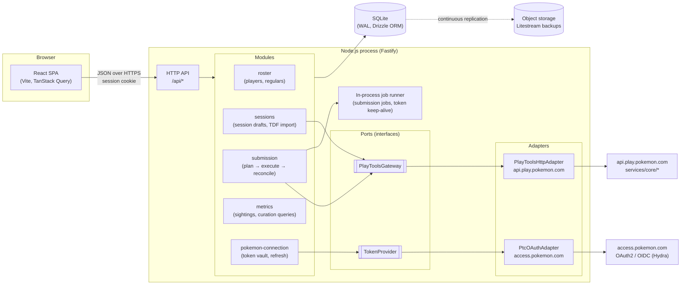
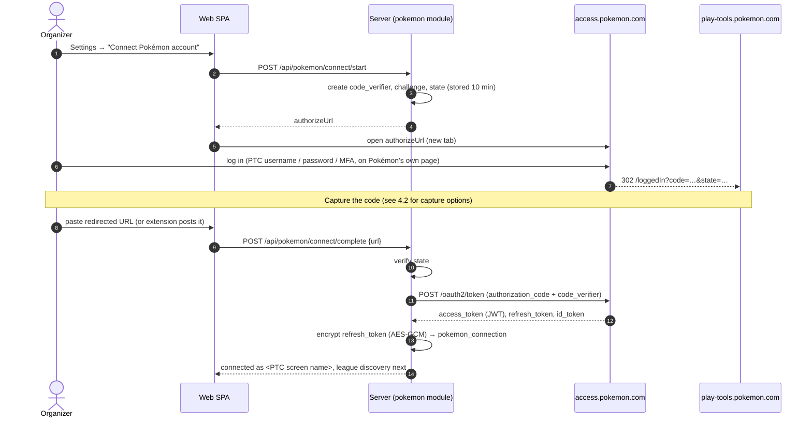
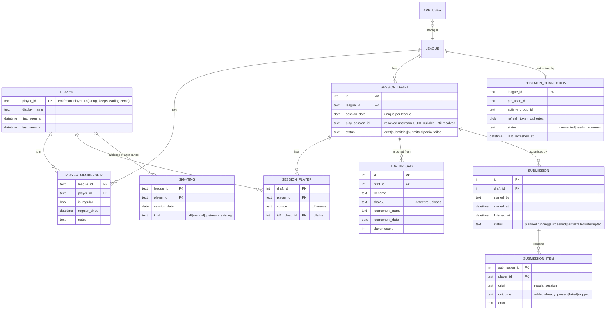
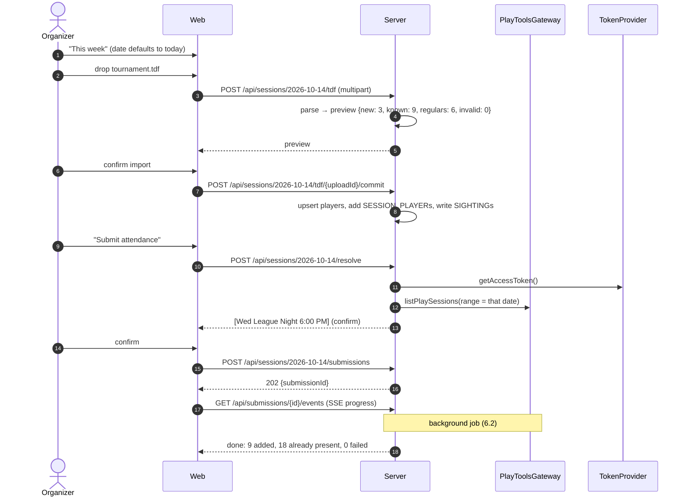
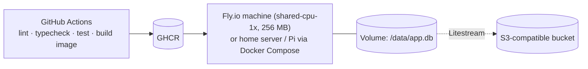

# Play! Pokémon League Attendance — System Architecture

Status: **Proposed** · Date: 2026-10-10 · Author: Martin Fracker, Jr.

## 1. Context

Taking attendance for a Play! Pokémon league in `play-tools.pokemon.com` means
entering players one at a time, every week. The predecessor CLI
([Towerism/play-pokemon-attendance](https://github.com/Towerism/play-pokemon-attendance))
removed most of that toil with three scripts:

| Script           | What it does                                                                                           |
| ---------------- | ------------------------------------------------------------------------------------------------------ |
| `extract-tdf.js` | Parses a tournament `.tdf` (XML) into `players.json` (`firstname lastname`, `userid`).                  |
| `index.js`       | Removes regulars from `players.json`, then `POST`s both lists to `.../play_sessions/{id}/records/_bulk/`, 15 s apart. |
| `delete.js`      | Pages through a session's records and deletes them one by one (to undo a bad run).                       |

Pain points that remain with the CLI:

1. A bearer token has to be copied by hand out of browser devtools on every run.
2. A play-session **GUID** has to be found and pasted in. The organizer thinks in *dates*.
3. The activity group (league) ID is hardcoded.
4. Rosters live in JSON files in a git repo. There is no history and no record of who actually shows up.
5. The run is not idempotent. Re-running it sends everyone again, and partial failures are only visible in console output.

## 2. Goals and non-goals

### Goals (v1)

- **G1 Regular players.** Maintain a curated list of players who are entered every session.
- **G2 Session players.** Maintain the list of non-regular players for a specific session date: add them by hand or by …
- **G3 TDF import.** … uploading a `.tdf`, which extracts its players into the session players (deduplicated against regulars and against the existing session list).
- **G4 Submit attendance.** One click. The app obtains a valid JWT from `access.pokemon.com` **without manual token copying**, asks *which date* the attendance is for, resolves that date to the play session, and uploads regulars ∪ session players with no duplicates.
- **G5 Metrics.** Every player ID that ever enters the system is tracked, with enough metrics to curate the regulars list by hand (promote frequent non-regulars, demote regulars who stopped coming).

### Non-goals (v1)

- Replacing any other play-tools feature (tournaments, staff, reporting).
- Real-time multi-user editing. One or two organizers per league is the expected load.
- Storing Pokémon Trainer Club **passwords** (see [ADR-0003](adr/0003-pokemon-auth-pkce-refresh-token.md)).
- Storing minors' birthdates or other PII from the TDF beyond name and player ID.

### Quality attributes (ranked)

1. **Correctness of submitted attendance.** Wrong or duplicate records are the worst outcome.
2. **Low operator effort.** The weekly flow is ≤ 3 clicks once the TDF is uploaded.
3. **Security of the Pokémon credential.** The refresh token can act as the organizer in play-tools.
4. **Cheap and easy to run.** A hobby budget, with one container and one file of data.
5. **Resilience to upstream change.** The play-tools API is unofficial and undocumented, so changes must stay contained in one adapter.

## 3. Architecture at a glance

**Pattern:** a modular monolith, with a hexagonal (ports and adapters) boundary
around the Pokémon integration. One team, one deployable, tiny scale. See
[ADR-0001](adr/0001-modular-monolith-typescript.md).



### Tech stack

| Layer            | Choice                                                                    | Why                                                                                                  |
| ---------------- | ------------------------------------------------------------------------- | ---------------------------------------------------------------------------------------------------- |
| Language         | TypeScript everywhere                                                     | One language. Shared Zod schemas between client and server. The existing code is already JS.        |
| Frontend         | React 19 + Vite + TanStack Query + React Router + Tailwind / shadcn/ui     | Plain SPA. No SSR needed behind a login. TanStack Query fits the server-state-heavy UI.              |
| Backend          | Fastify 5 + Zod (`fastify-type-provider-zod`)                             | Small and fast, with first-class schema validation. It serves the built SPA too, so there is one origin and no CORS. |
| Database         | SQLite (WAL) via Drizzle ORM + drizzle-kit migrations                      | Thousands of rows, not millions. Zero ops. See [ADR-0002](adr/0002-sqlite-drizzle.md).               |
| Backups          | Litestream → S3-compatible bucket (Backblaze B2 / R2)                     | Continuous, point-in-time restore of a single file.                                                  |
| XML              | `fast-xml-parser` (entities disabled)                                     | Same parser the CLI uses, with the TDF shape already proven.                                         |
| Crypto           | Node `crypto` AES-256-GCM (refresh-token vault), `@node-rs/argon2` (app passwords) | No extra service is needed.                                                                   |
| Packaging        | Single Docker image, pnpm workspace                                       | Runs on Fly.io, a VPS, or a Raspberry Pi at the store.                                               |
| Testing          | Vitest, MSW (HTTP fakes for the Pokémon APIs), Playwright for one happy-path E2E |                                                                                               |

### Repository layout (pnpm workspace)

```
apps/
  web/                 React SPA
  server/              Fastify app; composition root wires adapters → ports
    src/modules/
      roster/          players + regulars
      sessions/        session drafts, TDF import
      submission/      planner, executor, reconciler
      metrics/         sightings + curation queries
      pokemon/         connection (token vault), ports, adapters
      auth/            app users & sessions
    src/jobs/          job runner, keep-alive
    src/db/            drizzle schema + migrations
packages/
  shared/              Zod DTOs, PlayerId type, date helpers
  tdf/                 pure TDF parser (no I/O), heavily unit-tested
docs/architecture/     this document + ADRs
```

Module rule: modules talk to each other only through their exported service
interfaces, never through each other's tables. Only `pokemon/adapters/*` may
import an HTTP client that targets `*.pokemon.com`.

## 4. Pokémon integration (the risky part)

The integration was reverse-engineered from the current production play-tools
bundle (`play-tools.pokemon.com/assets/index-*.js`) and the existing CLI.

### 4.1 Identity: access.pokemon.com

- The server is OAuth2/OIDC on Ory Hydra (`/oauth2/auth`, `/oauth2/token`, `/oauth2/sessions/logout`).
- play-tools uses **authorization code + PKCE (S256)** as a **public client**:
  - `client_id=op-tools-app`
  - `scope=openid organized_play offline`
  - `audience=https://op-core.pokemon.com`
  - `redirect_uri=https://play-tools.pokemon.com/loggedIn`
- Token requests are `application/x-www-form-urlencoded` to `https://access.pokemon.com/oauth2/token`.
- Because of `offline`, a **refresh token** is issued. The refresh call is
  `grant_type=refresh_token&client_id=op-tools-app&refresh_token=…`, with no client secret.

**Design ([ADR-0003](adr/0003-pokemon-auth-pkce-refresh-token.md)):** connect once, then refresh forever.



After connecting, `TokenProvider.getAccessToken()`:

1. Returns the cached access token if it is valid for at least 2 more minutes.
2. Otherwise takes a **per-connection mutex** and calls the refresh grant.
3. **Persists the rotated refresh token in the same transaction** before anything else. Hydra rotates refresh tokens and reusing an old one revokes the whole chain.
4. If the refresh returns `invalid_grant`, marks the connection `needs_reconnect`, surfaces a banner in the UI and fails the job with a clear message.

A **keep-alive job** refreshes once a day so the chain never ages out during a
week off. The real refresh-token TTL is spike S2.

### 4.2 Capturing the authorization code

The redirect URI is fixed to play-tools, so our app cannot receive the
callback directly. Options, in order of preference (spike S1 decides):

| # | Mechanism                                                                                               | UX                    | Notes                                                                                                                     |
| - | ------------------------------------------------------------------------------------------------------- | --------------------- | ------------------------------------------------------------------------------------------------------------------------- |
| a | **Paste-back:** after login, copy the `…/loggedIn?code=…` URL from the address bar into our app         | One paste, once a month or less | Works only if the code is still unused when pasted. The play-tools SPA will see a `state` it didn't create; S1 checks whether it tries to redeem the code anyway. |
| b | **Companion browser extension** (MV3, ~50 lines): watches navigations to `play-tools.pokemon.com/loggedIn?code=` and posts the URL to our app (optionally stopping the navigation) | Zero-touch | Most reliable capture. An extra install, but only for the organizer.                                                      |
| c | **Manual access-token paste** (status quo)                                                              | Every session         | Always-available fallback, kept behind "Advanced".                                                                        |

Rejected: storing the PTC password and driving a headless browser
(`Playwright`) to log in. It stores the most sensitive credential, it breaks
on CAPTCHA/MFA, and it looks the most like "automated means" under the
play-tools Terms. Details are in ADR-0003.

### 4.3 Organized Play API: api.play.pokemon.com/services/core

Base: `https://api.play.pokemon.com/services/` (the OP gateway). Endpoints used:

| Purpose               | Method & path                                                                 |
| --------------------- | ----------------------------------------------------------------------------- |
| Discover leagues      | `GET core/users/{userId}/activity_groups/` (userId = JWT `sub` / profile)     |
| List play sessions    | `GET core/activity_groups/{groupId}/play_sessions/?status=active\|scheduled\|completed&page=&page_size=` |
| Existing attendance   | `GET core/activity_groups/{groupId}/play_sessions/{sessionId}/records/?player=true&page=&page_size=` |
| Bulk add attendance   | `POST core/activity_groups/{groupId}/play_sessions/{sessionId}/records/_bulk/` body `[{participant:{player_id}, role:null, player:true, origin:"roster", updated:""}]` |
| Remove one record     | `DELETE core/activity_groups/{groupId}/play_sessions/{sessionId}/records/{recordId}/` |

`PlayToolsGateway` port (the domain never sees raw payloads):

```ts
interface PlayToolsGateway {
  listLeagues(): Promise<League[]>;
  listPlaySessions(groupId: string, range: DateRange): Promise<PlaySession[]>; // {id, startsAt, endsAt, status, title}
  listAttendance(groupId: string, sessionId: string): Promise<AttendanceRecord[]>; // {recordId, playerId}
  addAttendanceBulk(groupId: string, sessionId: string, playerIds: PlayerId[]): Promise<BulkResult>;
  removeAttendance(groupId: string, sessionId: string, recordId: string): Promise<void>;
}
```

The adapter is the only place that knows about Pokémon's JSON shapes,
pagination quirks (`results` vs `data`), and headers. Responses are parsed
with Zod using `passthrough()`, and an unexpected shape fails loudly with the
raw body logged. Outbound calls are throttled (default ≥ 15 s between bulk
batches, matching the CLI's empirically safe spacing, and configurable) and
retried with backoff on 429/5xx only.

### 4.4 Resolving "which play session?" from a date

1. The organizer picks a **date** (defaults to today in the league timezone, e.g. `America/Chicago`).
2. The server lists play sessions whose start falls in `[date 00:00, date+1 00:00)` in the league TZ. It queries `active`, then `completed`, then `scheduled`, short-circuiting on the first match. Results are cached for 5 minutes.
3. 0 matches: "No play session exists on 2026-10-14 in play-tools — create it there first" (with a deep link).
   1 match: auto-select and show it for confirmation.
   More than 1 (e.g. an afternoon and an evening session): the user chooses.
4. The resolved `play_session_id` is stored on the session draft, so the history always points to the exact upstream session.

## 5. Domain model and data



Key modelling decisions:

- **`player_id` is TEXT.** Player IDs are opaque strings (the CLI already does `String(p.userid)`), and storing them as text avoids losing leading zeros.
- **Regular is a membership flag, not a separate list.** Promoting or demoting is one toggle, and the metrics are already in the same row.
- **Sightings ≠ submissions.** Regulars are submitted **every week whether or not they came**, so "submitted" carries *no* information about presence. A **sighting** is evidence: the player appeared in a TDF, was added by hand, or was already recorded upstream by someone else. Curation metrics are computed from sightings, which is the core insight that makes G5 useful.
- **The session-player list is per date** (`SESSION_DRAFT`). Uploading two TDFs on the same night (e.g. a TCG and a VGC event) merges them, keyed by `player_id`. Re-uploading the same file (same `sha256`) is a no-op.
- **TDF privacy.** The parser reads `userid`, `firstname`, `lastname` and tournament metadata only. Birthdates and other fields are never persisted, and the raw file is discarded after parsing.

### Metrics (SQL views, computed on read — the data is small)

Per player, per league:

| Metric                         | Definition                                                          | Used for                     |
| ------------------------------ | ------------------------------------------------------------------- | ---------------------------- |
| `sightings_total`              | count of distinct session dates with a sighting                     | general                      |
| `sightings_last_4w / 8w / 12w` | windowed counts                                                     | promote / demote             |
| `attendance_rate_8w`           | sightings ÷ league sessions held in last 8 weeks                    | promote / demote             |
| `first_seen`, `last_seen`      | min / max sighting date                                             | new-player follow-up         |
| `current_streak`               | consecutive league sessions with a sighting                         | promote                      |
| `weeks_since_last_seen`        | today − last_seen (in sessions)                                     | demote                       |
| `times_submitted`              | count of `SUBMISSION_ITEM.outcome in (added, already_present)`      | audit only                   |

Curation views on the Players page, with thresholds configurable in Settings:

- **Promotion candidates:** not regular, and `sightings_last_8w ≥ 4`.
- **Stale regulars:** regular, and no TDF or manual sighting in the last 6 sessions. Caveat: regulars who come but skip the tournament never get a TDF sighting, so the UI offers a per-session "mark present" checkbox for regulars to capture that evidence cheaply.

## 6. Core flows

### 6.1 Weekly flow (happy path)



### 6.2 Submission job: plan → execute → reconcile

The job is idempotent by construction. It never asks "did I send this
before?", only "what is upstream missing?".

1. **Plan**
   - `desired = regulars ∪ session_players`, as a set of `player_id`.
   - `existing = listAttendance(session)`, paging until exhausted.
   - `toAdd = desired − existing`.
   - `existing − desired` is reported, never deleted automatically (someone may have added a walk-in in play-tools).
   - Players in `existing ∩ desired` become `SUBMISSION_ITEM(outcome = already_present)`. Upstream players unknown locally become `SIGHTING(kind = upstream_existing)` and new `PLAYER` rows, so *every player ID that enters the system* is tracked.
2. **Execute**
   - Send session players before regulars, as the CLI did.
   - Chunk into batches of ≤ 50. Batches are ≥ 15 s apart (configurable), and the token is re-fetched per batch.
   - Progress events are persisted, then pushed over SSE.
3. **Reconcile**
   - Re-read `listAttendance`. Each `toAdd` player present upstream becomes `added`; the rest become `failed`, with the per-player error from the bulk response when present.
   - Set the submission status to `succeeded`, `partial` or `failed`.
   - **Retry** re-runs the same job, and because of step 1 it only sends what is still missing.
4. **Crash safety.** On boot, any `running` submission becomes `interrupted`, and the UI offers **Resume**, which runs the plan again from scratch.

A per-league lock (DB row with lease) prevents two submissions for the same
session from running concurrently.

### 6.3 Undo (port of `delete.js`)

From History, an organizer can open **Remove players added by this
submission**. It deletes only records whose `player_id` is in that
submission's `added` set. It is never "delete everyone", unless the organizer
uses the separate danger-zone action **Clear session**, which requires typing
the date to confirm.

## 7. HTTP API (server ↔ SPA)

All routes are under `/api`, require an app session cookie, and are validated with shared Zod schemas.

| Method & path                                             | Purpose                                                     |
| --------------------------------------------------------- | ----------------------------------------------------------- |
| `POST /auth/login` · `POST /auth/logout` · `GET /auth/me` | App login (organizer accounts)                              |
| `GET /players?filter=promote\|stale\|all&q=`              | Players with metrics                                        |
| `PATCH /players/{playerId}`                               | Rename, notes, `isRegular`                                  |
| `GET /regulars` · `POST /regulars` · `DELETE /regulars/{playerId}` | Regular list CRUD                                   |
| `POST /regulars/import`                                   | One-time import of the CLI's `regulars.json`                |
| `GET /sessions/{date}`                                    | Draft for a date: session players, regulars, resolved session |
| `POST /sessions/{date}/players` · `DELETE /sessions/{date}/players/{playerId}` | Manual session players         |
| `POST /sessions/{date}/tdf` → preview · `POST /sessions/{date}/tdf/{uploadId}/commit` | TDF import          |
| `POST /sessions/{date}/resolve`                           | Date → upstream play session candidates                     |
| `POST /sessions/{date}/submissions` → 202                 | Start submission job (body: `playSessionId`)                |
| `GET /submissions/{id}` · `GET /submissions/{id}/events` (SSE) · `POST /submissions/{id}/retry` | Job status          |
| `POST /submissions/{id}/undo`                             | Remove the records this submission added                    |
| `GET /pokemon/connection` · `POST /pokemon/connect/start` · `POST /pokemon/connect/complete` · `POST /pokemon/token` (manual fallback) · `DELETE /pokemon/connection` | Pokémon connection |
| `GET /leagues/upstream` · `PUT /settings`                 | Pick activity group, timezone, thresholds, batch delay      |

## 8. Frontend

| Route           | Contents                                                                                                                      |
| --------------- | ----------------------------------------------------------------------------------------------------------------------------- |
| `/` This week   | Date picker; TDF dropzone with preview diff; session-player table (add by ID + name); regulars count with expander; big **Submit attendance** button; progress drawer |
| `/regulars`     | Sortable list with each regular's last-seen and 8-week rate; add, remove, import JSON                                          |
| `/players`      | Every known player with metrics; tabs **Promotion candidates**, **Stale regulars**, **All**; one-click toggle regular          |
| `/history`      | Submissions by date with per-player outcomes, Retry and Undo                                                                   |
| `/settings`     | Pokémon connection status (connected as X, last refreshed, Reconnect); league; timezone; thresholds; batch delay; app users    |

A global banner appears when the Pokémon connection is `needs_reconnect`. The
layout is mobile-friendly, because attendance is often taken on a phone at the
store.

## 9. Security

| Threat                                                 | Control                                                                                                                                |
| ------------------------------------------------------ | -------------------------------------------------------------------------------------------------------------------------------------- |
| Theft of the refresh token (acts as the organizer in play-tools) | AES-256-GCM at rest with a key from env (`TOKEN_VAULT_KEY`), not in the DB. The token is never sent to the browser or logged. Disconnect revokes it at Hydra (`/oauth2/revoke`) and deletes the ciphertext. |
| Unauthorized use of the app                            | App accounts: argon2id passwords (or passkeys later). httpOnly, Secure, SameSite=Lax session cookies. Login rate-limited. Optionally deployed behind Tailscale or Cloudflare Access. |
| CSRF on state-changing routes                          | SameSite=Lax plus required `Content-Type: application/json` (or a CSRF token on the multipart TDF upload)                              |
| Malicious TDF (XXE, billion-laughs, huge file)         | `fast-xml-parser` with `processEntities:false`, no DTD handling, 2 MB upload limit, a 2,000-player cap, Zod validation of every player |
| OAuth `state` / code injection on connect              | `state` + PKCE verifier stored server-side and bound to the app user's session, with a 10-min TTL and single use                       |
| Minors' PII                                            | Only name and player ID are stored. No birthdates. Raw TDFs are not retained.                                                          |
| Supply chain                                           | Lockfile, Renovate, `pnpm audit` in CI                                                                                                 |

## 10. Deployment and operations



- **One container.** Fastify serves `/api` and the static SPA. Migrations run on boot.
- **Config (env):** `DATABASE_PATH`, `SESSION_SECRET`, `TOKEN_VAULT_KEY`, `PUBLIC_URL`, `LITESTREAM_*`.
- **Observability:** pino JSON logs, with redaction of `authorization` and `*token*`. `/healthz` and `/readyz` endpoints. The submission history in the UI *is* the audit log.
- **Expected cost:** about $0–5 per month.

## 11. Risks and mitigations

| Risk                                                                                                                                                          | Likelihood | Impact | Mitigation                                                                                                                                                                                       |
| ------------------------------------------------------------------------------------------------------------------------------------------------------------- | ---------- | ------ | ------------------------------------------------------------------------------------------------------------------------------------------------------------------------------------------------ |
| **Unofficial API / ToS.** play-tools Terms prohibit access "by use of automated means" and this reuses play-tools' public `client_id`. The CLI carries the same risk. | Med        | High   | Act only on the organizer's own league, at human-like volume. Make no calls the organizer wouldn't make by hand. Keep the manual-token fallback. Consider asking TPCi for sanctioned access. |
| Upstream API / auth changes                                                                                                                                   | Med        | Med    | All knowledge sits in two adapters, with Zod-validated responses and contract tests on recorded fixtures. The connection banner reports auth failures fast.                                      |
| Auth code capture (S1) doesn't work with paste-back                                                                                                           | Med        | Med    | Companion extension (option b), or the manual token as last resort                                                                                                                               |
| Refresh token TTL is short                                                                                                                                    | Low        | Low    | Daily keep-alive. If the TTL is under a week, reconnect is one click at the start of the session.                                                                                                |
| Rate limiting                                                                                                                                                 | Low        | Low    | Throttled batches, plus retry on 429 with `Retry-After`                                                                                                                                          |

## 12. Spikes before building (timeboxed, ≤ 1 day total)

| ID | Question                                                                                                          | How                                                                                            |
| -- | ----------------------------------------------------------------------------------------------------------------- | ---------------------------------------------------------------------------------------------- |
| S1 | Does a PKCE code issued for our verifier survive landing on `play-tools/loggedIn` long enough to paste?          | Node script: build the authorize URL, log in, paste, exchange. If not, prototype the MV3 extension. |
| S2 | Refresh-token lifetime and rotation behaviour                                                                     | Refresh daily for a week; decode `exp` on tokens                                               |
| S3 | `play_sessions` response shape: date field, timezone, pagination, statuses                                        | Record fixtures with a real token                                                              |
| S4 | `_bulk` semantics: response shape, partial failures, posting an already-present player (error or no-op?)          | Bulk-add to a throwaway session, then undo                                                     |
| S5 | `userId` for `users/{id}/activity_groups/`: JWT `sub` or a separate profile ID?                                    | Decode the JWT and compare it with play-tools network calls                                    |

## 13. Delivery plan

| Milestone                     | Scope                                                                                                         |
| ----------------------------- | ------------------------------------------------------------------------------------------------------------- |
| M0 Spikes                     | S1–S5; freeze the adapter contracts and fixtures                                                              |
| M1 Skeleton                   | Workspace, Fastify + SPA, SQLite + migrations, app login, CI, Docker                                          |
| M2 Rosters                    | Players, regulars CRUD, `regulars.json` import, manual session players                                        |
| M3 TDF                        | `packages/tdf` parser, preview → commit, sightings                                                            |
| M4 Pokémon connection         | Token vault, connect flow, keep-alive, league discovery                                                       |
| M5 Submission                 | Date → session resolve, plan/execute/reconcile job, SSE, history, retry                                        |
| M6 Metrics and curation       | Views, Players page tabs, thresholds                                                                          |
| M7 Hardening                  | Undo, Litestream, E2E test, docs                                                                              |

## 14. Architecture Decision Records

- [ADR-0001](adr/0001-modular-monolith-typescript.md) Modular monolith in TypeScript (Fastify + React SPA)
- [ADR-0002](adr/0002-sqlite-drizzle.md) SQLite + Drizzle with Litestream backups
- [ADR-0003](adr/0003-pokemon-auth-pkce-refresh-token.md) Pokémon auth via one-time PKCE connect + stored refresh token
- [ADR-0004](adr/0004-idempotent-diff-based-submission.md) Idempotent diff-based submission (plan → execute → reconcile)
- [ADR-0005](adr/0005-sightings-based-metrics.md) Curation metrics from sightings, not submissions
